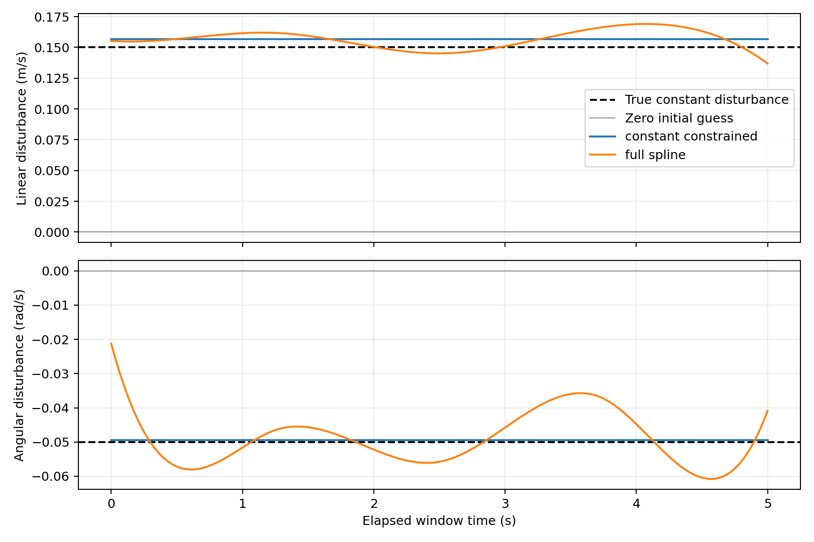
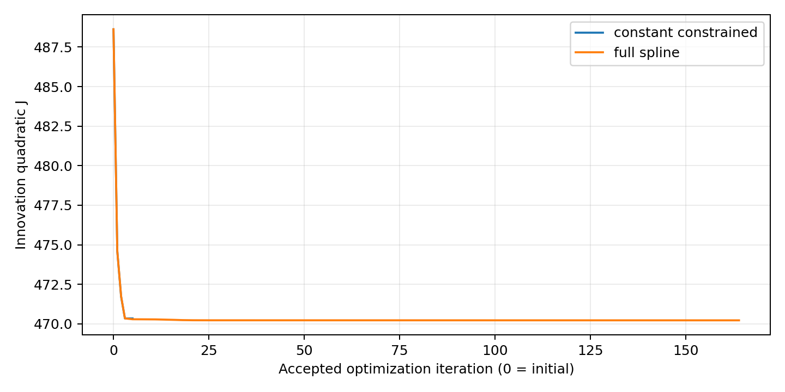

# Stage 4B — B-Spline Coefficient Optimization

Controlled constant-disturbance completion gate: **SATISFIED**. Scope: the documented seed-7 known-landmark noisy experiment, repeat runs, and noiseless controls. This is not a claim about smooth disturbances or other seeds.

The objective is the unchanged Stage 4A innovation quadratic over a fixed requested set. Both requested experiments use the identical saved Stage 4A seed-7 truth/observations and zero initial coefficients. All priors, commands, associations and measurement data remain fixed during each fit.

## Configuration and policy

```json
{
  "window_length_seconds": 5.0,
  "integration_step_seconds": 0.025,
  "measurement_interval_seconds": 0.1,
  "degree": 3,
  "segments": 4,
  "coefficients_per_channel": 7,
  "command_v_omega": [
    1.0,
    0.2
  ],
  "true_disturbance_v_omega": [
    0.15,
    -0.05
  ],
  "seed": 7,
  "initial_pose": [
    0.0,
    0.0,
    0.0
  ],
  "arrival_covariance": [
    [
      0.0025000000000000005,
      0.0,
      0.0
    ],
    [
      0.0,
      0.0025000000000000005,
      0.0
    ],
    [
      0.0,
      0.0,
      0.0012184696791468343
    ]
  ],
  "measurement_covariance": [
    [
      0.0025000000000000005,
      0.0
    ],
    [
      0.0,
      0.00030461741978670857
    ]
  ],
  "continuous_input_noise_spectral_density_Qc": [
    [
      0.01,
      0.0
    ],
    [
      0.0,
      0.0025
    ]
  ],
  "landmark_coordinates": [
    [
      5.0,
      2.0
    ],
    [
      7.0,
      -4.0
    ],
    [
      1.0,
      7.0
    ],
    [
      -4.0,
      4.0
    ],
    [
      -5.0,
      -3.0
    ],
    [
      3.0,
      -7.0
    ]
  ],
  "covariance_tolerance": 1e-10,
  "observation_policy": "all six landmarks at positive 0.1 s multiples; no arrival-time observation",
  "jax_enable_x64": true
}
```

L-BFGS-B parameter bounds are [-0.5,0.5]. Preflight checks include the initial point, axis endpoints, sign patterns and eight seed-7 interior points. These deterministic probes do not prove validity throughout the box. Every SciPy request is checked; an invalid candidate aborts the run without returning a partial cost, NaN gradient or finite penalty. No automatic domain adjustment is implemented.

Only J is minimized. Log determinant and Gaussian sums are diagnostic. Constant parameters z=[a,b] map to c=[a*ones(7); b*ones(7)], and JAX differentiates this composition.

## Files added or changed

- `estimation/coefficient_optimization.py`: checked SciPy interface, constant mapping, feasibility probes, optimization histories, reconstruction metrics and local sensitivities.
- `benchmarks/milestone4b.py`: paired reproducible experiments, diagnostic controls, plots and reports.
- `tests/test_coefficient_optimization.py`, `estimation/STAGE4B.md`, `project.md`: validation and documented scope/status.
- `artifacts/milestone4b/`: report, validation record, JSON results, saved datasets, sensitivities, dense disturbance curves and figures.

## Optimization results

| Fit | Status | Initial J | Final J | Iterations | Function / gradient calls | Raw gradient L2 | Projected gradient infinity norm |
|---|---|---:|---:|---:|---|---:|---:|
| constant_constrained | converged: CONVERGENCE: REL_REDUCTION_OF_F_<=_FACTR*EPSMCH | 488.6270263800142 | 470.34078987309533 | 5 | 7 / 7 | 5.538152561506025e-06 | 4.731563279375406e-06 |

**constant_constrained coefficients:** `[0.1565395086832717, 0.1565395086832717, 0.1565395086832717, 0.1565395086832717, 0.1565395086832717, 0.1565395086832717, 0.1565395086832717, -0.04950449361307867, -0.04950449361307867, -0.04950449361307867, -0.04950449361307867, -0.04950449361307867, -0.04950449361307867, -0.04950449361307867]`.

Objective reduction: `18.28623650691884`.

Disturbance RMSE / maximum absolute error, [linear, angular]: `{'rmse_v_omega': [0.006539508683271703, 0.0004955063869213338], 'max_absolute_error_v_omega': [0.006539508683271772, 0.0004955063869213489]}`.

Final position error norm / signed wrapped heading error: `0.006027027788568838` m / `0.002042291951774078` rad.

Timing (seconds): `{'evaluation_compile_seconds': 0.7150615419959649, 'value_gradient_compile_seconds': 2.394251042016549, 'checked_reference_first_call_seconds_including_auxiliary_compilation': 2.4065672919969074, 'compiled_value_gradient_warmup_seconds': 0.015681249991757795, 'preparation_seconds': 5.6412942910101265, 'optimization_seconds': 0.1243022499838844, 'validity_check_seconds_mean': 0.004023964425349342, 'validity_check_seconds_p95': 0.004203596198931336, 'value_gradient_seconds_mean': 0.013280767855966198, 'value_gradient_seconds_p95': 0.014729225003975442}`.

Invalid trials: `[]`. Feasibility probes: 17.

Estimated [a,b]: `[0.1565395086832717, -0.04950449361307867]`; signed errors relative to truth: `[0.006539508683271716, 0.000495506386921335]`.

| full_spline | converged: CONVERGENCE: REL_REDUCTION_OF_F_<=_FACTR*EPSMCH | 488.6270263800142 | 470.2218646778345 | 164 | 181 / 181 | 0.0001817937635173188 | 0.00011729545106960821 |

**full_spline coefficients:** `[0.1926468064169455, 0.14106508090952086, 0.1749284929253218, 0.13007272905414044, 0.1756119791880581, 0.16657958390400404, -0.020426488021108115, 0.33002660433052405, -0.10851894886599567, -0.02361111899210016, -0.07620104408238874, -0.006238018709778123, -0.12270239681926053, 0.251921697570824]`.

Objective reduction: `18.40516170217967`.

Disturbance RMSE / maximum absolute error, [linear, angular]: `{'rmse_v_omega': [0.009946191777413203, 0.007699597661696299], 'max_absolute_error_v_omega': [0.019056321606677834, 0.02872328164574021]}`.

Final position error norm / signed wrapped heading error: `0.006149007443096305` m / `0.0020678683983641477` rad.

Timing (seconds): `{'evaluation_compile_seconds': 0.6013575829856563, 'value_gradient_compile_seconds': 2.3488757089944556, 'checked_reference_first_call_seconds_including_auxiliary_compilation': 2.5658616250148043, 'compiled_value_gradient_warmup_seconds': 0.015203957998892292, 'preparation_seconds': 5.7219892910216, 'optimization_seconds': 3.2889744999993127, 'validity_check_seconds_mean': 0.004235543098875697, 'validity_check_seconds_p95': 0.004592499986756593, 'value_gradient_seconds_mean': 0.013601760392512055, 'value_gradient_seconds_p95': 0.014300000009825453}`.

Invalid trials: `[]`. Feasibility probes: 41.

## Likelihood diagnostics

| Candidate | J | Sum log determinant | J + sum log determinant |
|---|---:|---:|---:|
| zero | 488.62702638 | -4052.24324748 | -3563.6162211 |
| true | 470.362078442 | -4051.88470222 | -3581.52262377 |
| constant_optimized | 470.340789873 | -4051.86770873 | -3581.52691886 |
| full_optimized | 470.221864678 | -4051.80905152 | -3581.58718684 |

## Local identifiability

D is the Jacobian of stacked prior innovations with respect to c, evaluated by JAX forward differentiation. Each 2-row block is whitened as solve(cholesky(S_k), D_k), with S fixed at that candidate for this diagnostic. The optimization itself retains dS/dc. These local linearized sensitivities do not prove global identifiability or provide calibrated uncertainty for this experiment.

Numerical rank threshold: max(rows,columns)*float64_epsilon*sigma_max. A separate practical rank uses 1e-3*sigma_max; it is a scale-relative conditioning diagnostic, not a statistical identifiability threshold.

| Evaluation | Matrix | Shape | Numerical rank | Rank tolerance | Practical rank | Condition number | Singular values |
|---|---|---|---:|---:|---:|---:|---|
| zero | raw | [600, 14] | 14 | 1.177e-13 | 14 | 77.25655677212573 | [0.8833422518065575, 0.5613908798441241, 0.5051016300489487, 0.4134920967780415, 0.39871803854583265, 0.2855826431050368, 0.24604979842056315, 0.1725475131952237, 0.14919045626863084, 0.11847168231023966, 0.022476843942719794, 0.014136191318485005, 0.013155732174830053, 0.011433880679047664] |
| zero | whitened | [600, 14] | 14 | 2.781e-12 | 14 | 94.87078379339137 | [20.871782580494806, 16.8299049335494, 11.789267961622114, 10.483462397278563, 8.483414654155755, 7.083303126915816, 5.916457060806459, 4.903794624558492, 3.5551331955409555, 2.4464143795253666, 0.55715588269174, 0.43172978776336324, 0.29372227434990156, 0.2200022150754985] |
| optimized | raw | [600, 14] | 14 | 1.293e-13 | 14 | 84.73892515328218 | [0.9708680218759297, 0.5613290377801019, 0.4948252987643246, 0.41495725610204076, 0.3948943930849952, 0.2866448644460132, 0.24433694027174999, 0.17344911393522167, 0.14870708543089284, 0.11897607085953221, 0.022217157363305737, 0.014184236090094572, 0.013135943999003316, 0.011457167058937201] |
| optimized | whitened | [600, 14] | 14 | 2.776e-12 | 14 | 94.94909301546329 | [20.83781541416067, 16.858567828816266, 11.806238227613447, 10.454695341139272, 8.498726290630104, 7.090750244690815, 5.93341894400944, 4.908346198507214, 3.552177783670512, 2.4394236251571084, 0.5588612829104657, 0.43215399775810126, 0.2870034206801745, 0.21946302752746724] |

Full matrices and dense reconstruction samples are saved in sensitivities.npz and disturbance_curves.npz. Accepted-iteration and trial-evaluation histories, convergence status, coefficients, final poses/covariances/errors, repetition results and all timings are in results.json.

## Plots





## Timing interpretation

Explicit lower/compile times contain compilation without execution. The checked-reference first-call time may include auxiliary JAX VJP compilation and is labelled separately. Preparation includes compilation, warmup and probes. Optimization runtime starts only after preparation, using the warmed compiled pair and host validity checks. These measurements cover a fixed-window fit, not moving-horizon update latency.

## Current test record

Completion evidence checks: `{'required_experiments_and_diagnostics_present': True, 'primary_fits_converged': True, 'valid_trials_and_final_candidates': True, 'objective_reduction': True, 'both_channels_reconstructed_better_than_zero': True, 'paired_repeat_reproducibility': True, 'local_sensitivity_dimensions_and_rank': True, 'noiseless_controls': True, 'current_complete_test_suite': True}`.

This benchmark does not execute pytest. The following record is supplied separately; null means no current test record was supplied.

```json
{
  "command": "PYTHONPATH=build/bsplines_library python3 -B -m pytest -q --junitxml=/tmp/stage4b_pytest.xml -o junit_family=legacy",
  "exit_code": 0,
  "passed": 248,
  "elapsed_seconds": 117.40516150000622,
  "recorded_at_utc": "2026-11-12T23:44:12.310136+00:00",
  "scope": "complete repository suite",
  "stdout": "........................................................................ [ 29%]\n........................................................................ [ 58%]\n........................................................................ [ 87%]\n................................                                         [100%]\n----------------- generated xml file: /tmp/stage4b_pytest.xml ------------------\n248 passed in 114.24s (0:01:54)\n"
}
```

## Scope and remaining validation

Additional interpretation, noise-free controls, completion-gate assessment and preservation audit are recorded in validation.md. Stage 4C, moving windows, nearest-neighbor association and Victoria Park are not implemented.

## Interpretation and completion assessment

The full spline reduces J by an additional 0.118925 relative to the constant fit but has larger disturbance RMSE in both channels. Noiseless controls recover both channels to about 1e-7 or better. Both primary fits stopped on relative objective reduction, with projected gradient norms above the requested gradient tolerance; a tighter-ftol control barely changes reconstruction. Numerical full rank is a local diagnostic, not a global identifiability or uncertainty guarantee.

The controlled constant-disturbance gate is satisfied with 248 tests passed and all 117 protected files unchanged. Smooth disturbances and other noise realizations remain unvalidated. See the [validation and interpretation record](validation.md) and [machine-readable audit](validation.json) for complete controls, timing interpretation, failure-policy tests, preservation hashes and scope limits.

After the recorded numerical experiments, a serialization-only patch made rejected nonfinite parameters JSON-safe. Valid-candidate computations are unchanged. The final code passed all 248 tests; the recorded numerical experiments were retained.
