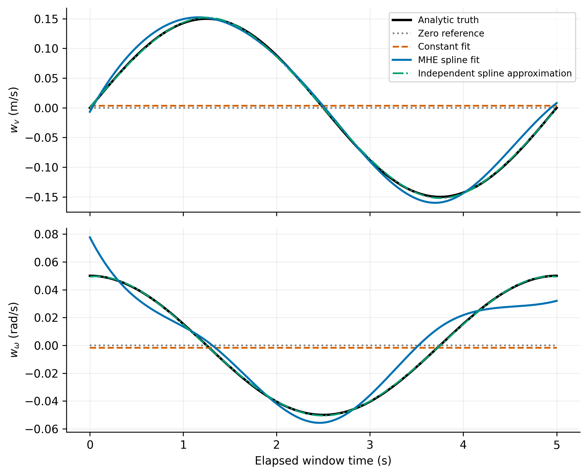
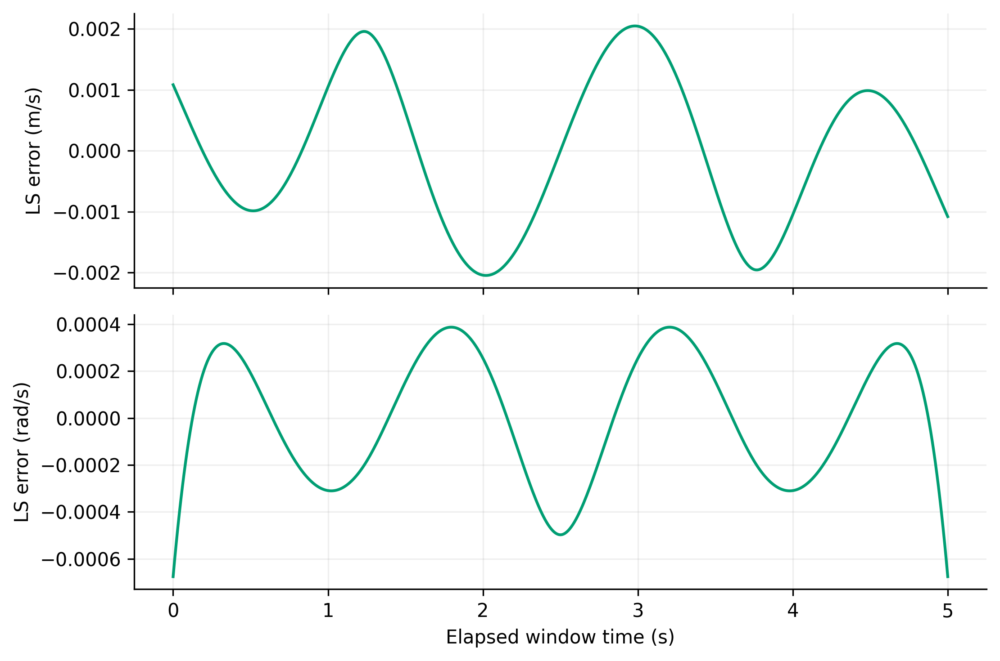
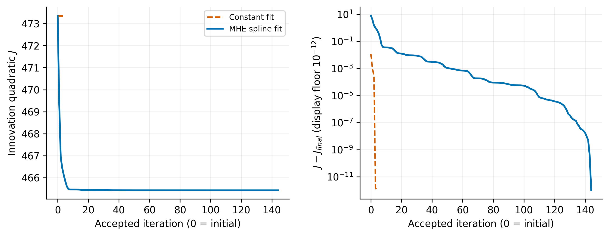
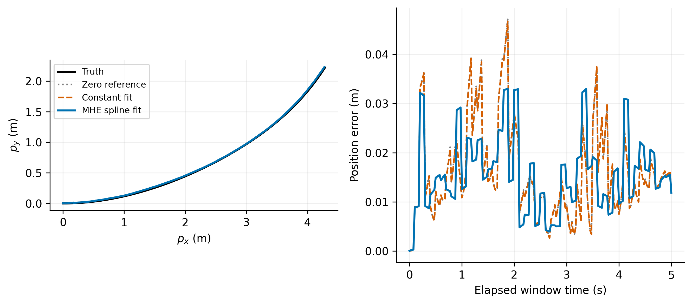

# Stage 4B extension — smooth time-varying disturbance reconstruction

Controlled smooth reconstruction validation: **PASSED**.

Full spline / constant disturbance RMSE ratios (linear, angular): `[0.0830715056513275, 0.2595586487359097]`. Full spline reduces J by 7.92649392 (1.6745%) beyond the constant fit, and by 7.93826367 relative to zero.

This is one seed-7, fixed-window, known-landmark experiment. Experiment labels zero/constant/full below are parameterization comparisons, separate from the project’s preserved SLAM Baselines A/B.

## Reproduction and fixed configuration

```sh
PYTHONPATH=build/bsplines_library MPLCONFIGDIR=/tmp/bspline_mhe_mpl python3 -B -m benchmarks.milestone4b_smooth --test-record artifacts/milestone4b_smooth/test_record.json
```

Configuration: [configuration.json](configuration.json). L=5 s, cubic degree 3, M=4, seven coefficients per channel, c=[c_v;c_omega], alpha=M/L=0.8. Commands [1.0,0.2], estimator RK4 step 0.025 s, observations every 0.1 s, all six landmarks in fixed order, no observation at arrival: 300 updates and 600 innovation components. The arrival mean/covariance, R and Qc are copied from the validated constant configuration. One immutable Stage 4A evaluator and one dataset are shared by all primary comparisons. Qc remains a nonzero estimator uncertainty assumption; truth is deterministic apart from measurement noise.

Dataset SHA-256 (canonical concatenated arrays): `a5655f1669a0b2cb0730f6b27bad47bf5737bfc0a23febaeeab5a17ab9a20af9`.

True disturbances are 0.15 sin(2 pi sigma/5) m/s and 0.05 cos(2 pi sigma/5) rad/s. SciPy DOP853 integrates these analytic functions independently of JAX, RK4 and the C++ spline. Primary max step 0.05 s, rtol=1e-11, atol=1e-13; refinement halves the step and tightens tolerances tenfold. Maximum pose component differences: `[1.7763568394002505e-15, 6.661338147750939e-16, 5.551115123125783e-16]` (acceptance <1e-10). Both refinements are independent of estimator propagation.

## Objective, constraints and optimization

Only the unchanged innovation quadratic J=sum(r.T solve(S,r)) is minimized. No regularization, log determinant or finite failure penalty is added. The constant fit uses z=[a,b] and c=[a ones(7);b ones(7)]. Both fits start at zero, use the existing checked L-BFGS-B/JAX gradients and bounds [-0.5,0.5]. Every candidate retains all requested measurements; an invalid preflight/trial stops the experiment with a failure record. Deterministic feasibility probes do not certify the whole box.

| Model | Initial J | Final J | Status | Iterations | Function / gradient evaluations | Gradient L2 / inf | Projected gradient inf |
|---|---:|---:|---|---:|---|---|---:|
| zero | 473.363950495 | 473.363950495 | reference_not_optimized | 0 | 0 / 0 | 53.8736 / 31.8398 | 31.8398 |
| constant_constrained | 473.363950495 | 473.352180745 | converged | 4 | 6 / 6 | 1.23288e-09 / 1.14406e-09 | 1.14406e-09 |
| full_spline | 473.363950495 | 465.425686826 | converged | 144 | 156 / 156 | 0.00476214 / 0.0047559 | 0.000164046 |

Zero has no optimizer calls; its full-coefficient gradient norms are diagnostic only. Raw and projected gradient infinity norms are reported because SciPy function-reduction convergence can precede the configured gtol=1e-6. The other unchanged primary stopping settings include ftol=1e-12 and maxiter=500. A successful function-reduction termination does not establish strict stationarity or global optimality.

**constant_constrained:** CONVERGENCE: NORM_OF_PROJECTED_GRADIENT_<=_PGTOL. Coefficients: `[0.0033179859908230454, 0.0033179859908230454, 0.0033179859908230454, 0.0033179859908230454, 0.0033179859908230454, 0.0033179859908230454, 0.0033179859908230454, -0.001727759733619974, -0.001727759733619974, -0.001727759733619974, -0.001727759733619974, -0.001727759733619974, -0.001727759733619974, -0.001727759733619974]`.

**full_spline:** CONVERGENCE: REL_REDUCTION_OF_F_<=_FACTR*EPSMCH. Coefficients: `[-0.5, 0.06323555018721849, 0.20719244270010306, 0.01759113610586122, -0.26002448396141126, 0.06610635872595483, 0.04429489734470444, 0.35001885338579347, 0.02299686643139386, 0.02380127916166104, -0.09933839637452761, 0.04014760266542144, 0.016937557643066405, 0.08413692582674837]`.

## Reconstruction and localization

Disturbance errors use the same 501 uniform samples, including endpoints. Maximum errors are sampled maxima. Pose RMSE uses all 201 posterior integration nodes (including arrival); heading differences wrap to [-pi,pi]. Position RMSE is sqrt(mean(dx²+dy²)); heading RMSE is sqrt(mean(wrapped heading error²)).

| Model | w_v RMSE (m/s) | w_omega RMSE (rad/s) | Max abs w_v / w_omega | Position RMSE (m) | Heading RMSE (rad) | Final position (m) | Final signed heading (rad) |
|---|---:|---:|---|---:|---:|---:|---:|
| zero | 0.10596011 | 0.0353906062 | [0.15, 0.05] | 0.0185280834 | 0.0061672528 | 0.0118081248 | -0.00164999851 |
| constant_constrained | 0.106012046 | 0.0354376216 | [0.15331798599082305, 0.051727759733619975] | 0.0184633822 | 0.00611710448 | 0.011838278 | -0.00169127018 |
| full_spline | 0.0088065803 | 0.00919814118 | [0.019220728715150993, 0.02763459971217165] | 0.0174461312 | 0.00638827554 | 0.0118380443 | -0.00104601483 |

Relative to the constant constraint, full-spline linear/angular disturbance RMSE changes by `[-91.69284943486726, -74.04413512640903]` percent. Position/heading RMSE changes by `[-5.509559510061446, 4.432996931572641]` percent. Disturbance recovery and localization therefore need separate assessment; a lower disturbance RMSE does not ensure every pose metric improves.


## Independent spline approximation

Unconstrained least squares on the dense C++ basis gives RMSE `[0.0012090725254914737, 0.00026732627550645773]`, maximum errors `[0.0020456730852657368, 0.0006757873515137666]`, rank 7, and normal-equation residual 4.18e-15. Its diagnostic innovation J is 465.611319754. This is the best sampled linear least-squares approximation on the specified grid, not an estimator, a continuous-time minimax bound or optimized EKF result. Its coefficients never initialize an optimization. The analytic functions are outside the finite cubic spline family.

## Fixed measurements, covariance and likelihood diagnostics

Log determinant and Gaussian diagnostic J+sum(logdet S) are preserved diagnostics only; the Gaussian diagnostic omits the dimension-dependent constant. The fixed-S column recomputes each candidate residual quadratic using the zero-reference innovation covariance blocks, isolating residual changes from S changes.

| Model | Requested / valid / rejected | logdet sum | J + logdet | Mean S diagonal / zero | Fixed-S quadratic | Unweighted residual square sum (range, bearing) |
|---|---|---:|---:|---|---:|---|
| zero | 300 / 300 / 0 | -4062.626076 | -3589.262126 | [1.0, 1.0] | 473.3639505 | [0.718305972648826, 0.09883522106019454] |
| constant_constrained | 300 / 300 / 0 | -4062.620103 | -3589.267922 | [0.9999973625788583, 1.0000591395370808] | 473.3531458 | [0.7183162320472678, 0.09881499528701052] |
| full_spline | 300 / 300 / 0 | -4062.715143 | -3597.289456 | [1.0001836195964382, 0.9989800805571358] | 465.4632092 | [0.7016219444987525, 0.09680778578996398] |

Residual quadratic improves with S fixed at zero reference: **True**. All priors/posteriors and innovation covariances pass the unchanged domain checks. Full per-record covariance trace ratio min/mean/p95/max is retained in results.json. These checks expose covariance effects without treating them as an extra optimization objective.

## Sensitivity and boundary errors

Raw D stacks innovation derivatives; W=blockdiag(cholesky(S)^-1)D freezes S for whitening at the evaluated point. The objective gradient still includes dS/dc. Numerical rank uses max(rows,cols)*epsilon64*sigma_max; practical rank uses 1e-3*sigma_max. These are local diagnostics and do not establish global identifiability.

| Experiment / point | Matrix | Shape | Numerical / practical rank | Condition number | Singular values |
|---|---|---|---|---:|---|
| smooth / zero | raw | [600, 14] | 14 / 14 | 53.34159 | [0.5839339849360068, 0.497068537019688, 0.45875781070285526, 0.40663062179573933, 0.31874255623541103, 0.2825238400314224, 0.1946654273396296, 0.1695316018213509, 0.13282850530103, 0.11658596414575659, 0.016020869467727246, 0.01365465703071643, 0.012171351789027816, 0.01094706741981259] |
| smooth / zero | whitened | [600, 14] | 14 / 14 | 95.494206 | [20.87061458729315, 16.932520456761704, 11.830490729804772, 10.418376411861992, 8.422642715519919, 7.1030509684786525, 5.886196068794493, 4.914516874692498, 3.5325618753627115, 2.4309265141672842, 0.5615325858893073, 0.43235592801765155, 0.27969291214477676, 0.21855372697546807] |
| smooth / optimized | raw | [600, 14] | 14 / 14 | 53.257363 | [0.5827237479941669, 0.4950018574009197, 0.4578784373823301, 0.4057019101721091, 0.31945149696050085, 0.2824636988039111, 0.19479584532413854, 0.16906115346678097, 0.13285648960320995, 0.11640283512537636, 0.016001533725102768, 0.013652242049880102, 0.012173191648536075, 0.01094165608969775] |
| smooth / optimized | whitened | [600, 14] | 14 / 14 | 95.404213 | [20.852925385909476, 16.88803124768895, 11.824841936945433, 10.408575801933162, 8.413765824740995, 7.099497463235582, 5.877965462622437, 4.91309311677533, 3.5298431443332863, 2.4296527382881816, 0.5613026326640046, 0.43239628196346275, 0.2792808845322808, 0.21857447055687584] |
| constant / zero | raw | [600, 14] | 14 / 14 | 77.256557 | [0.8833422518065575, 0.5613908798441241, 0.5051016300489487, 0.4134920967780415, 0.39871803854583265, 0.2855826431050368, 0.24604979842056315, 0.1725475131952237, 0.14919045626863084, 0.11847168231023966, 0.022476843942719794, 0.014136191318485005, 0.013155732174830053, 0.011433880679047664] |
| constant / zero | whitened | [600, 14] | 14 / 14 | 94.870784 | [20.871782580494806, 16.8299049335494, 11.789267961622114, 10.483462397278563, 8.483414654155755, 7.083303126915816, 5.916457060806459, 4.903794624558492, 3.5551331955409555, 2.4464143795253666, 0.55715588269174, 0.43172978776336324, 0.29372227434990156, 0.2200022150754985] |
| constant / optimized | raw | [600, 14] | 14 / 14 | 84.738925 | [0.9708680218759297, 0.5613290377801019, 0.4948252987643246, 0.41495725610204076, 0.3948943930849952, 0.2866448644460132, 0.24433694027174999, 0.17344911393522167, 0.14870708543089284, 0.11897607085953221, 0.022217157363305737, 0.014184236090094572, 0.013135943999003316, 0.011457167058937201] |
| constant / optimized | whitened | [600, 14] | 14 / 14 | 94.949093 | [20.83781541416067, 16.858567828816266, 11.806238227613447, 10.454695341139272, 8.498726290630104, 7.090750244690815, 5.93341894400944, 4.908346198507214, 3.552177783670512, 2.4394236251571084, 0.5588612829104657, 0.43215399775810126, 0.2870034206801745, 0.21946302752746724] |

Relative to the LS approximation coefficients, 98.083% of fitted coefficient error energy lies in the weakest four whitened right singular directions. Total reconstruction RMSE at the first/last 0.5 s is `[0.013688046484611594, 0.014903235100067233]` versus `[0.007034554387885741, 0.007032443954319613]` in the interior. The weak-four reconstructed error RMSE is `[0.007718200946281703, 0.009876289505439527]` at boundaries and `[0.002802150317561522, 0.0030991494225257243]` in the interior. Boundary errors and the boundary contribution of weak directions are larger here. The weak-direction function does not explain the entire error: its cosine with the fit-minus-LS function error is `[0.3574983804776162, 0.5247253728080514]`. This examines function errors as well as coefficient projections; coefficient energy alone is parameterization dependent.

## Noise diagnostic and constant-experiment comparison

A separately labelled zero-start noiseless full-spline control gives disturbance RMSE `[0.0012203199495266098, 0.00028031782640704596]` and J=0.0007607289635 (converged). It preserves geometry, truth and configured R/Qc, but removes sampled measurement noise. It does not replace the noisy primary comparisons. The noiseless/LS RMSE ratios are `[1.0093025222209595, 1.0485981068489258]`, while noisy/noiseless full-fit RMSE ratios are `[7.21661585479775, 32.81325807683566]`. Near-approximation-level noiseless recovery supports measurement noise as a substantial contributor to the larger primary reconstruction errors, consistent with the weak-direction/boundary diagnostics. This does not prove any one factor is the only error source.

| Truth experiment | Fit | Final J | Disturbance RMSE (linear, angular) |
|---|---|---:|---|
| constant | constant_constrained | 470.340789873 | [0.006539508683271703, 0.0004955063869213338] |
| constant | full_spline | 470.221864678 | [0.009946191777413203, 0.007699597661696299] |
| smooth | constant_constrained | 473.352180745 | [0.10601204620803681, 0.03543762161742007] |
| smooth | full_spline | 465.425686826 | [0.008806580295679722, 0.009198141181432017] |

The constant experiment favors its correctly specified constant constraint; its full spline fits noise with a slightly lower objective and worse reconstruction. The smooth experiment tests a restricted model that cannot follow the injected variation. Cross-experiment objective differences are descriptive because truth and observations differ. Within each experiment, data and prior are paired.

## Timing and reproducibility

| Model | Evaluation compile (s) | Value/gradient compile (s) | Checked cold reference incl. auxiliary compilation (s) | Warm optimization (s) | Steady value/gradient mean / p95 (s) | Steady checked evaluation mean / p95 (s) |
|---|---:|---:|---:|---:|---|---|
| zero | 0.68967 | 2.38278 | 2.37686 | 0 | 0.0129082 / 0.0136233 | 0.00388513 / 0.00397514 |
| constant_constrained | 0.595954 | 2.35321 | 2.39741 | 0.103001 | 0.012545 / 0.0131147 | 0.00402747 / 0.00407656 |
| full_spline | 0.610091 | 2.44643 | 2.4885 | 2.76108 | 0.0132957 / 0.0143438 | 0.004131 / 0.0045342 |

Explicit lower/compile times exclude execution; the cold checked reference may include auxiliary VJP compilation. Warm optimization includes checked trial evaluations and gradients, after preparation. Zero timing uses ten repeated evaluations. These are fixed-window offline timings, not moving-horizon latency. Environment: `{'python': '3.12.6', 'numpy': '2.0.2', 'scipy': '1.14.1', 'jax': '0.4.35', 'jax_backend': 'cpu', 'jax_enable_x64': True, 'platform': 'macOS-14.7.6-arm64-arm-64bit'}`. Both fitted models repeat from zero on the identical dataset; maximum coefficient differences: `[0.0, 0.0]`. Repeats are deterministic checks, not Monte Carlo trials or statistical confidence intervals.

## Figures and saved evidence









Each figure also has a vector PDF. results.json contains complete metrics, histories, timings, diagnostics and the previous constant sensitivity comparison. Additional files: dataset.npz, configuration.json, optimization_histories.json, disturbance_curves.npz/.csv, localization.npz, sensitivities.npz and sensitivity_diagnostics.json. Validation/test and preservation records are retained separately.

## Validation gate and limitations

```json
{
  "independent_truth_refinement": true,
  "all_primary_candidates_valid": true,
  "fits_converged_without_invalid_trials": true,
  "same_requested_observations": true,
  "objective_numpy_consistency": true,
  "gradients": true,
  "sampled_ls_normal_equations": true,
  "full_spline_reconstructs_both_channels_better_than_zero": true,
  "full_spline_reduces_residual_cost_with_reference_covariances": true,
  "paired_repeat_reproducibility": true,
  "current_complete_test_suite": true
}
```

Finite-difference checks use float64 and steps 1e-4/1e-5, with atol=rtol=2e-5 and maximum absolute discrepancy <2e-5; all perturbations must remain valid. Actual gradient checks passed: True.

No test requires full-spline reconstruction to beat the constant fit. The validation checks establish numerical and experimental correctness; the measured RMSEs determine the performance conclusion.

Smooth time-varying reconstruction is validated for this controlled scenario. Stage 4B is ready to transition to planning Stage 4C within this scope; Stage 4C implementation is not started. General reliability across seeds, abrupt disturbances, noise levels and sparse measurements remains unvalidated. Monte Carlo trials are required for final comparisons. Stage 4C must first define initialization/arrival measurement accounting; moving windows, nearest-neighbor association and Victoria Park remain outside this task.

## Final verification and constraint note

The complete repository suite passed **270 tests**, with no failures, skips or warnings. Exact commands, execution evidence, the preservation audit and interpretation are in [validation.md](validation.md) and [test_record.json](test_record.json). All **135 pre-existing protected files** match their pre-implementation hashes.

The first linear coefficient is at its lower bound -0.5; the remaining coefficients are interior. This constraint contributes to the difference between raw and projected gradients and can affect boundary reconstruction. Weak sensitivity, measurement noise and the coefficient box must be considered together; this result is a constrained fit, with no claim of an unconstrained or global optimum.
