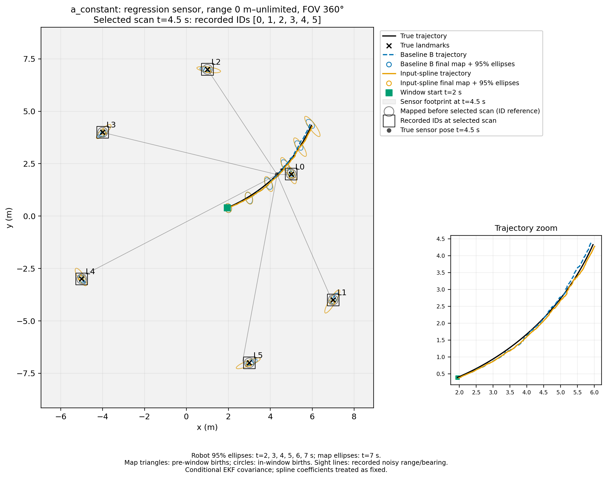
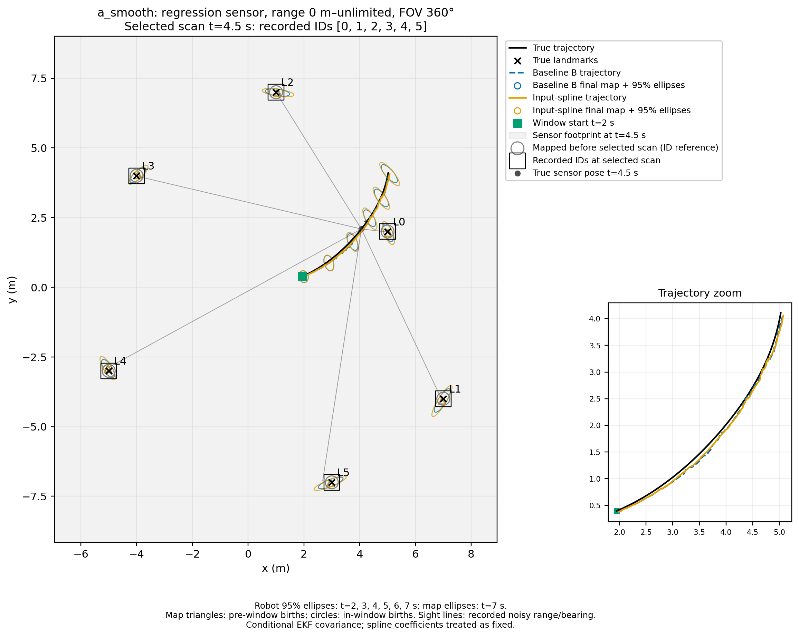
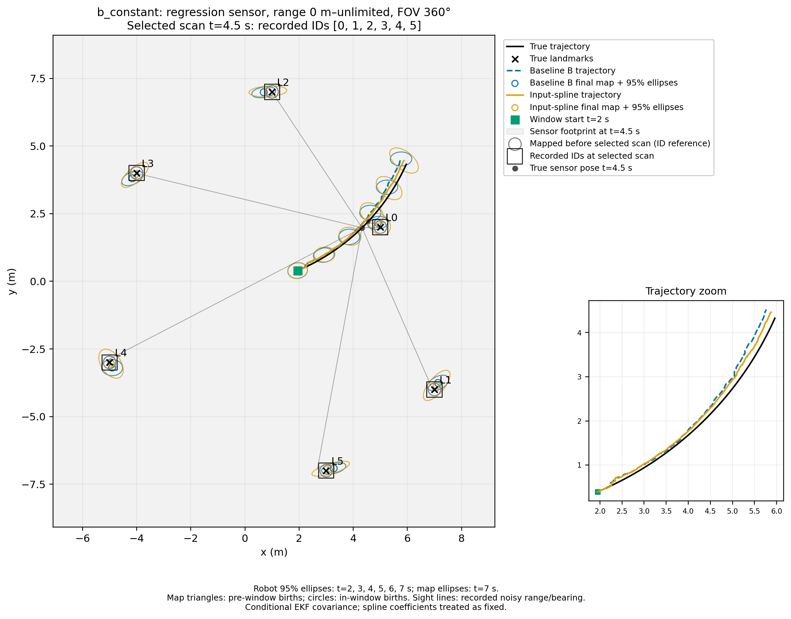
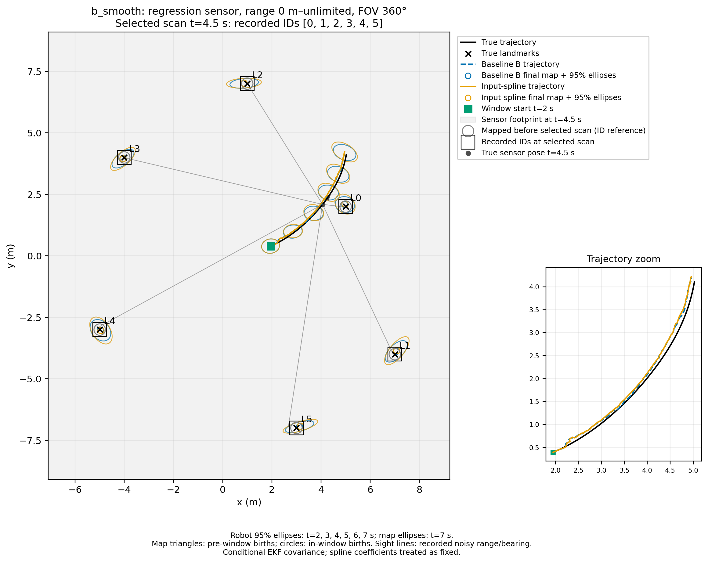
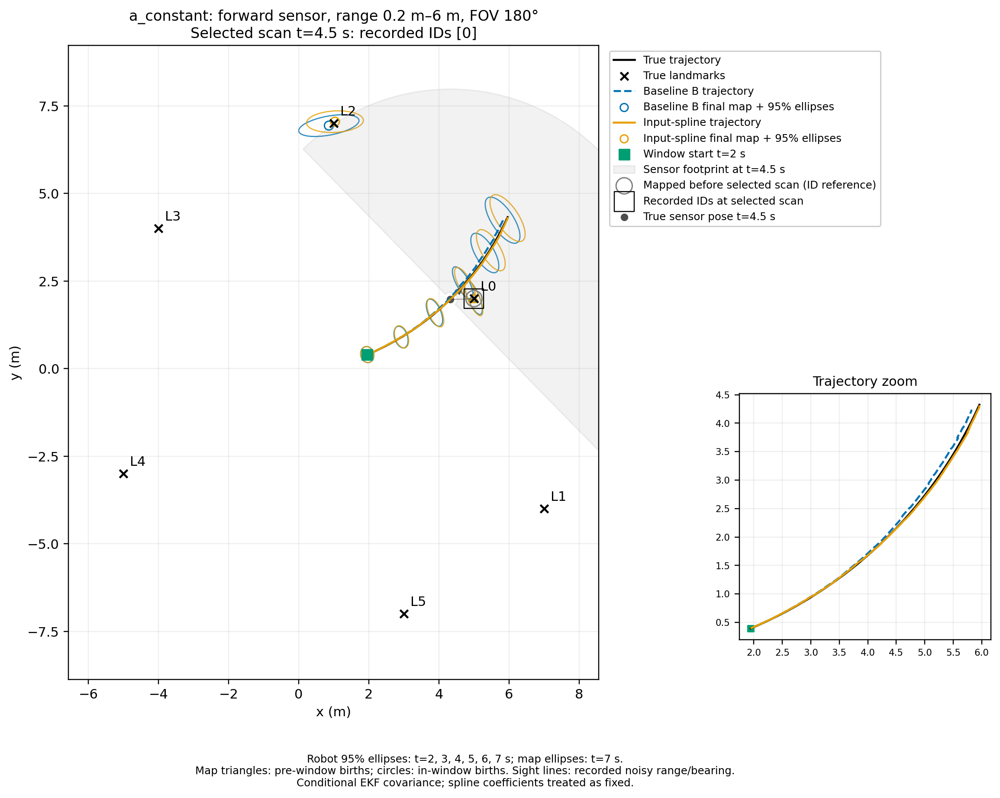
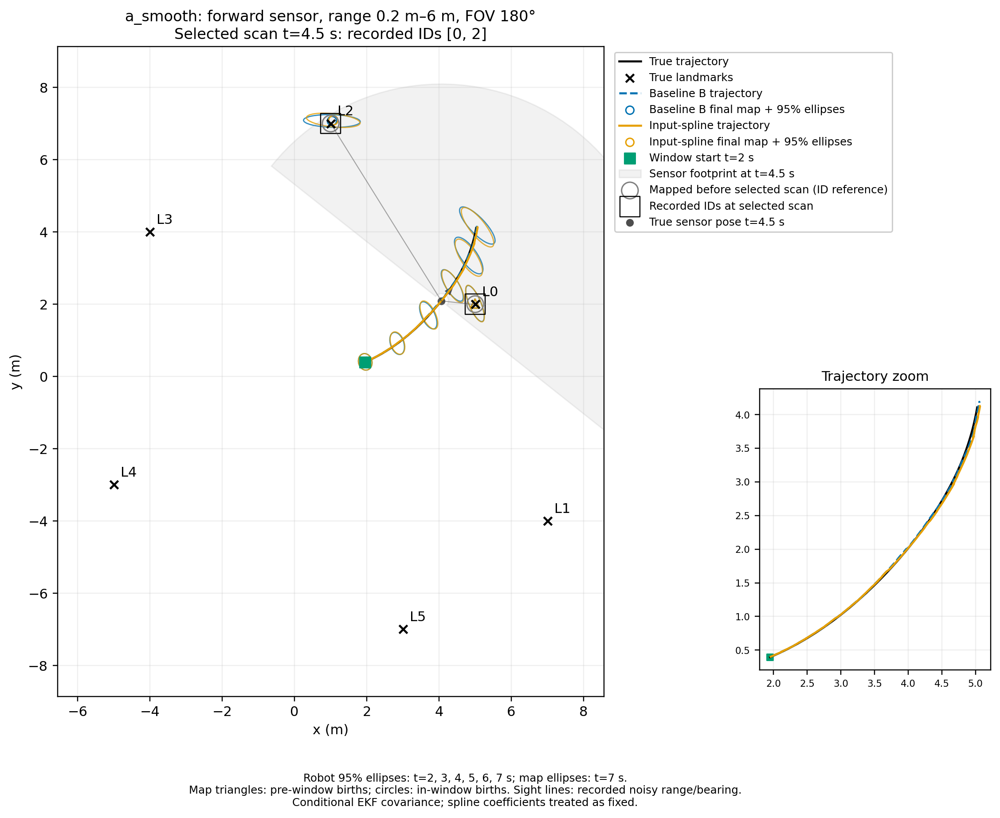
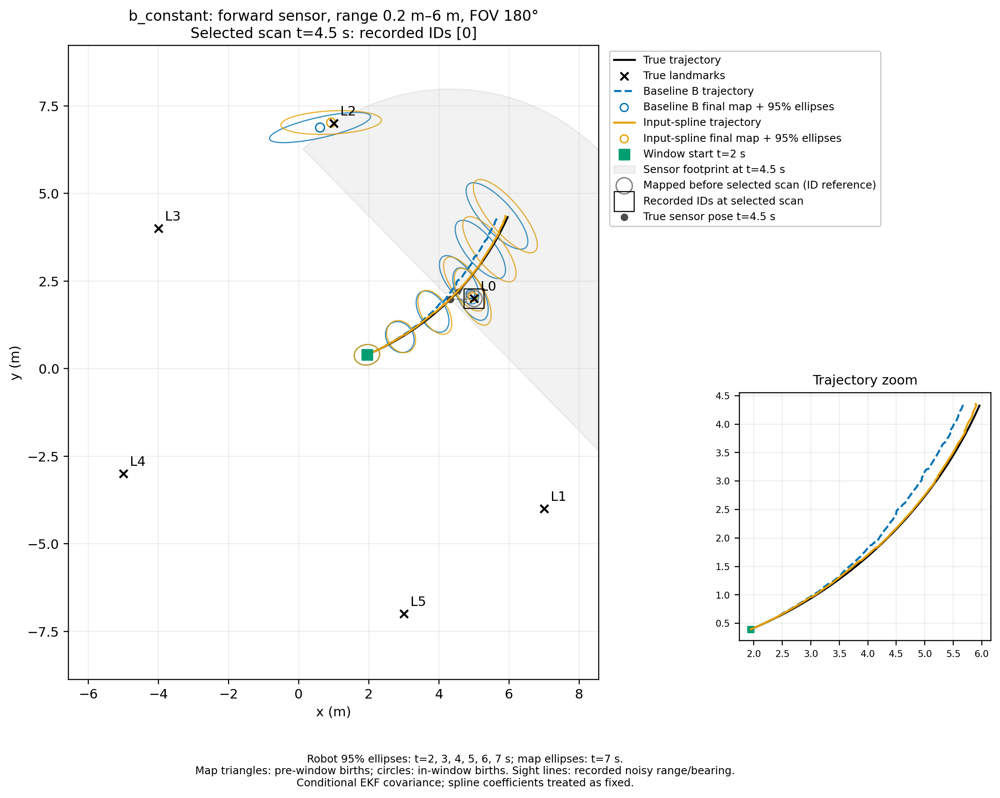
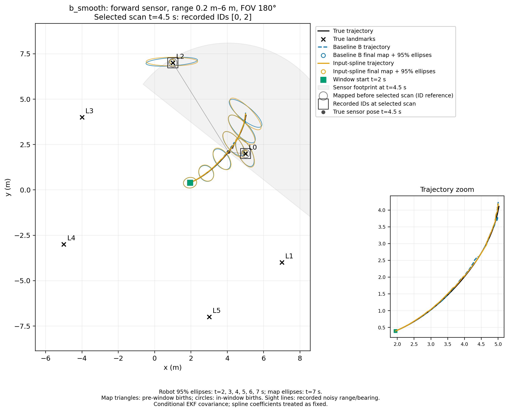

# Stage 4C visibility audit and SLAM maps

These are paired seed-7 fixed-window checks, with two identical zero-start fits per case. They are not Monte Carlo trials or a Milestone 5 result. Full audit and assumptions: [STAGE4C_VISIBILITY.md](../../estimation/STAGE4C_VISIBILITY.md).

Regression sensor: unlimited range, 360° FOV. Illustrative forward sensor: 0.2–6 m inclusive range, 180° FOV centered on robot heading. Both have zero extrinsics, no occlusion and no random detection dropout. Visibility uses noiseless true geometry. The same full-slot seeded noise stream pairs shared observations across scenarios.

Configuration A uses only valid measurements at 0.1–2 s to construct its full arrival posterior. Configuration B propagates the original robot prior to 2 s without observations and has an empty map. Both replay exactly the same records strictly after 2 s. No map prior is supplied.

| Case | Pre/window records | Arrival/final mapped | Birth times (ID: seconds) | Unmapped IDs |
|---|---:|---:|---|---|
| regression/a_constant | 120/300 | 6/6 | {'0': 0.1, '1': 0.1, '2': 0.1, '3': 0.1, '4': 0.1, '5': 0.1} | [] |
| regression/a_smooth | 120/300 | 6/6 | {'0': 0.1, '1': 0.1, '2': 0.1, '3': 0.1, '4': 0.1, '5': 0.1} | [] |
| regression/b_constant | 120/300 | 0/6 | {'0': 2.1, '1': 2.1, '2': 2.1, '3': 2.1, '4': 2.1, '5': 2.1} | [] |
| regression/b_smooth | 120/300 | 0/6 | {'0': 2.1, '1': 2.1, '2': 2.1, '3': 2.1, '4': 2.1, '5': 2.1} | [] |
| forward/a_constant | 20/53 | 1/2 | {'0': 0.1, '2': 4.7} | [1, 3, 4, 5] |
| forward/a_smooth | 20/60 | 1/2 | {'0': 0.1, '2': 4.0} | [1, 3, 4, 5] |
| forward/b_constant | 20/53 | 0/2 | {'0': 2.1, '2': 4.7} | [1, 3, 4, 5] |
| forward/b_smooth | 20/60 | 0/2 | {'0': 2.1, '2': 4.0} | [1, 3, 4, 5] |

| Case | Birth/correction records in window | Empty scheduled scans / total | Used-observation coverage |
|---|---:|---:|---:|
| regression/a_constant | 0/300 | 0/70 | 1 |
| regression/a_smooth | 0/300 | 0/70 | 1 |
| regression/b_constant | 6/294 | 0/70 | 1 |
| regression/b_smooth | 6/294 | 0/70 | 1 |
| forward/a_constant | 1/52 | 0/70 | 1 |
| forward/a_smooth | 1/59 | 0/70 | 1 |
| forward/b_constant | 2/51 | 0/70 | 1 |
| forward/b_smooth | 2/58 | 0/70 | 1 |

Birth times come from recorded INITIALIZED statuses, not supplied map coordinates. Observation JSON files list actual IDs at every scheduled scan, including empty scans. Covariance ellipses and map markers only include active estimated landmarks.

| Case | Estimator | Position RMSE (m) | Heading RMSE (rad) | Map RMSE (m) | w_v RMSE (m/s) | w_omega RMSE (rad/s) | J |
|---|---|---:|---:|---:|---:|---:|---:|
| regression/a_constant | baseline_b | 0.0611604 | 0.0136128 | 0.08018185 | 0.15 | 0.05 | 504.382549 |
| regression/a_constant | optimized_mhe | 0.05588674 | 0.01164298 | 0.07218885 | 0.02416254 | 0.01795886 | 489.749966 |
| regression/a_smooth | baseline_b | 0.05898778 | 0.01310636 | 0.06123397 | 0.1059601 | 0.03539061 | 497.822151 |
| regression/a_smooth | optimized_mhe | 0.05686664 | 0.01214394 | 0.07992713 | 0.0211051 | 0.01762827 | 489.563322 |
| regression/b_constant | baseline_b | 0.1559699 | 0.03693996 | 0.2569699 | 0.15 | 0.05 | 496.060384 |
| regression/b_constant | optimized_mhe | 0.115447 | 0.02571428 | 0.1378081 | 0.01430886 | 0.01918461 | 480.740131 |
| regression/b_smooth | baseline_b | 0.08658617 | 0.02067375 | 0.1050147 | 0.1059601 | 0.03539061 | 489.547364 |
| regression/b_smooth | optimized_mhe | 0.100756 | 0.02426359 | 0.127645 | 0.01792588 | 0.01909022 | 480.717346 |
| forward/a_constant | baseline_b | 0.07677881 | 0.01841373 | 0.1106386 | 0.15 | 0.05 | 78.9952233 |
| forward/a_constant | optimized_mhe | 0.04687994 | 0.01243227 | 0.04528231 | 0.08246339 | 0.0140012 | 65.1633608 |
| forward/a_smooth | baseline_b | 0.07568187 | 0.01104119 | 0.05656893 | 0.1059601 | 0.03539061 | 79.3055134 |
| forward/a_smooth | optimized_mhe | 0.04883127 | 0.01561778 | 0.08198629 | 0.04408853 | 0.01363357 | 69.9195176 |
| forward/b_constant | baseline_b | 0.1744859 | 0.04420169 | 0.3101876 | 0.15 | 0.05 | 77.9634241 |
| forward/b_constant | optimized_mhe | 0.05236731 | 0.01582407 | 0.0698304 | 0.07846348 | 0.01750138 | 64.5630741 |
| forward/b_smooth | baseline_b | 0.08110755 | 0.01148412 | 0.07457504 | 0.1059601 | 0.03539061 | 79.2228378 |
| forward/b_smooth | optimized_mhe | 0.05512446 | 0.01623847 | 0.08182027 | 0.04316048 | 0.01821313 | 69.3125878 |

Errors use the original anchored frame with no post-fit alignment. Robot RMSE uses all 201 window nodes; map RMSE uses only mapped IDs at 7 s, so differing map coverage must accompany comparisons. Disturbance RMSE uses 501 elapsed samples. J sums correction innovations only; births contribute no term.

## Effect of reduced visibility

- a_constant: fitted linear/angular disturbance RMSE changes from [0.02416253520654162, 0.017958859828926244] to [0.08246339064817754, 0.014001201607404142].
- a_smooth: fitted linear/angular disturbance RMSE changes from [0.021105102538422356, 0.017628265602727122] to [0.04408852692717457, 0.013633569575534335].
- b_constant: fitted linear/angular disturbance RMSE changes from [0.014308864337270593, 0.019184610575048708] to [0.07846347874409805, 0.017501378889582076].
- b_smooth: fitted linear/angular disturbance RMSE changes from [0.01792588065687796, 0.019090221617503577] to [0.043160482627428484, 0.018213127890354085].

Reduced visibility removes correction constraints and changes map coverage. Lower innovation cost across different sensors is not an accuracy comparison. Weak constraints and measurement noise can harm disturbance recovery or pose/map accuracy. No noise, bounds, spline parameters or optimizer tolerances were tuned for the forward scenario.

- regression/a_smooth: fitting lowers J but worsens final_landmark_rmse_m relative to Baseline B.
- regression/b_smooth: fitting lowers J but worsens position_rmse_m, heading_rmse_rad, final_landmark_rmse_m relative to Baseline B.
- forward/a_smooth: fitting lowers J but worsens heading_rmse_rad, final_landmark_rmse_m relative to Baseline B.
- forward/b_smooth: fitting lowers J but worsens heading_rmse_rad, final_landmark_rmse_m relative to Baseline B.

## Figures and validation

Black crosses are all true landmark references. Blue and orange markers/ellipses are active final estimates; triangles identify pre-window births and circles in-window births. Green marks the window start. The gray footprint and sight lines use the labeled true sensor pose and actual recorded noisy range/bearing; squares identify observed IDs, gray circles IDs mapped before that scan. Robot 95% marginal ellipses occur at 2, 3, 4, 5, 6, 7 s; landmark ellipses are at 7 s. **Conditional EKF covariance; spline coefficients treated as fixed.**

















All per-case JSON files retain zero-replay equivalence to Baseline B (absolute tolerance 2e-14), all-coefficient central-difference checks (float64; steps 1e-4 and 1e-5), optimizer status/timing, observation/birth/correction counts, and exact repeated-fit checks. Regression dataset fields are compared bitwise to the original Stage 4C datasets. Original artifacts and preserved implementation hashes are checked in preservation.json.

```sh
PYTHONPATH=build/bsplines_library MPLCONFIGDIR=/tmp/bspline_mhe_mpl python3 -B -m benchmarks.milestone4c_visibility
PYTHONPATH=build/bsplines_library MPLCONFIGDIR=/tmp/bspline_mhe_mpl python3 -B -m pytest -q tests/test_slam_visibility.py tests/test_slam_window_a.py tests/test_slam_window_b.py tests/test_milestone4c_reporting.py
```

Next validation gate: resolve the already documented Milestone 5 arrival/birth/warm-start research decisions.

Test outcome: 306 passed, exit code 0; see [test_record.json](test_record.json) and [pytest_stdout.txt](pytest_stdout.txt).

```sh
PYTHONPATH=build/bsplines_library MPLCONFIGDIR=/tmp/bspline_mhe_mpl python3 -B -m pytest -q --junitxml=artifacts/milestone4c_visibility/pytest.xml
```

```json
{
  "eight_cases_present": true,
  "all_case_numerical_checks": true,
  "paired_datasets_across_arrivals": true,
  "regression_datasets_bitwise_identical": true,
  "record_accounting": true,
  "all_figures_present": true
}
```
