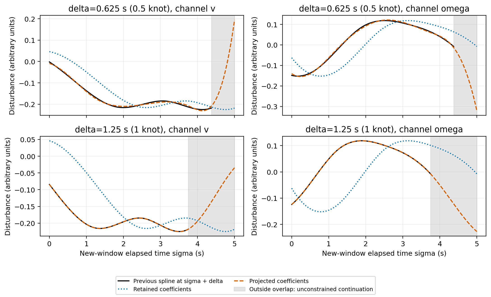

# Stage 5A — integral B-spline warm-start projection

Stage 5A numerical gate: **SATISFIED**. Stage 5B is not implemented.

The C++ uniform unclamped basis supplies every evaluation. Products use piecewise Gauss–Legendre quadrature, split at the new knots and shifted old knots. The default d+1 points integrate degree-2d products exactly on each span up to float64 roundoff. Flat coefficients remain [c_v;c_omega], reshaped as C with shape (2,M+d).

The cached map T solves G T = B, so C_new = C_old T.T satisfies C_new G = C_old B.T. A weighted-design QR solve avoids forming an inverse and avoids squaring the condition number during solution. Singular values of the weighted design determine Gram rank using lambda > n*eps*lambda_max. Condition numbers below are squared weighted-design singular-value ratios; exact structural singularity is infinity.

The SVD fallback solves only numerically resolved directions and retains an explicitly translated/repeated-terminal reference in unresolved directions. This is a rank-revealing numerical approximation when the exact Gram is full rank but ill-conditioned. It is not diagonal regularization or a change to the MHE objective. A constant channel component is separated before projection to avoid amplifying roundoff in the partition-of-unity identity.

## Errors and rank across configurations

| d | M | delta / knot | Numerical rank / n | Gram condition | Method | Normal residual max | Integrated projected / retained error |
|---:|---:|---:|---:|---:|---|---:|---:|
| 0 | 3 | 0 | 3/3 | 1 | zero_shift_identity | 0 | 0 / 0 |
| 0 | 3 | 0.08 | 3/3 | 1.08696 | full_rank_qr | 8.327e-17 | 0.009881693 / 0.01074097 |
| 0 | 3 | 0.37 | 3/3 | 1.5873 | full_rank_qr | 7.633e-17 | 0.0312965 / 0.04967699 |
| 0 | 3 | 0.5 | 3/3 | 2 | full_rank_qr | 8.327e-17 | 0.03356553 / 0.06713107 |
| 0 | 3 | 0.9 | 3/3 | 10 | full_rank_qr | 5.551e-17 | 0.01208359 / 0.1208359 |
| 0 | 3 | 1 | 2/3 | infinity | integer_knot_translation_repeat_terminal | 0 | 0 / 0.1342621 |
| 0 | 3 | 1.3 | 2/3 | infinity | rank_deficient_svd_reference_continuation | 5.551e-17 | 0.01942096 / 0.09785528 |
| 1 | 3 | 0 | 4/4 | 3.83712 | zero_shift_identity | 2.776e-17 | 0 / 0 |
| 1 | 3 | 0.08 | 4/4 | 4.65532 | full_rank_qr | 1.665e-16 | 0.0003476478 / 0.003542035 |
| 1 | 3 | 0.37 | 4/4 | 14.6935 | full_rank_qr | 1.665e-16 | 0.003272011 / 0.06532284 |
| 1 | 3 | 0.5 | 4/4 | 29.3565 | full_rank_qr | 2.498e-16 | 0.003356601 / 0.1107401 |
| 1 | 3 | 0.9 | 4/4 | 2905.16 | full_rank_qr | 1.11e-16 | 0.0001223009 / 0.2735684 |
| 1 | 3 | 1 | 3/4 | infinity | integer_knot_translation_repeat_terminal | 5.551e-17 | 3.565339e-32 / 0.3114334 |
| 1 | 3 | 1.3 | 3/4 | infinity | rank_deficient_svd_reference_continuation | 8.327e-17 | 4.303142e-05 / 0.413027 |
| 2 | 4 | 0 | 6/6 | 47.4308 | zero_shift_identity | 5.551e-17 | 0 / 0 |
| 2 | 4 | 0.08 | 6/6 | 70.4583 | full_rank_qr | 8.327e-17 | 8.767519e-05 / 0.002419335 |
| 2 | 4 | 0.37 | 6/6 | 498.012 | full_rank_qr | 1.11e-16 | 0.0008395452 / 0.04723077 |
| 2 | 4 | 0.5 | 6/6 | 1513.36 | full_rank_qr | 6.939e-17 | 0.0008272403 / 0.0823545 |
| 2 | 4 | 0.9 | 6/6 | 2.40482e+06 | full_rank_qr | 6.245e-17 | 5.219508e-05 / 0.2216834 |
| 2 | 4 | 1 | 5/6 | infinity | integer_knot_translation_repeat_terminal | 2.776e-17 | 7.99602e-33 / 0.2570535 |
| 2 | 4 | 1.3 | 5/6 | infinity | rank_deficient_svd_reference_continuation | 5.551e-17 | 0.0002860352 / 0.3396784 |
| 3 | 4 | 0 | 7/7 | 1501.46 | zero_shift_identity | 5.551e-17 | 0 / 0 |
| 3 | 4 | 0.08 | 7/7 | 2472.08 | full_rank_qr | 1.11e-16 | 1.043623e-05 / 0.0009479322 |
| 3 | 4 | 0.37 | 7/7 | 31217.7 | full_rank_qr | 5.551e-17 | 0.0001119857 / 0.01755513 |
| 3 | 4 | 0.5 | 7/7 | 133414 | full_rank_qr | 5.551e-17 | 0.0001200601 / 0.03003359 |
| 3 | 4 | 0.9 | 7/7 | 3.21745e+09 | full_rank_qr | 2.776e-17 | 8.310821e-06 / 0.07787871 |
| 3 | 4 | 1 | 6/7 | infinity | integer_knot_translation_repeat_terminal | 8.327e-17 | 6.117702e-33 / 0.09025 |
| 3 | 4 | 1.3 | 6/7 | infinity | rank_deficient_svd_reference_continuation | 4.163e-17 | 2.962918e-05 / 0.1230362 |
| 5 | 2 | 0 | 7/7 | 2.12398e+07 | zero_shift_identity | 8.674e-18 | 0 / 0 |
| 5 | 2 | 0.08 | 7/7 | 3.87564e+07 | full_rank_qr | 5.594e-17 | 8.969026e-10 / 0.0006778276 |
| 5 | 2 | 0.37 | 7/7 | 1.09972e+09 | full_rank_qr | 8.327e-17 | 2.17285e-09 / 0.01204834 |
| 5 | 2 | 0.5 | 7/7 | 8.2146e+09 | full_rank_qr | 5.551e-17 | 7.930313e-10 / 0.0197451 |
| 5 | 2 | 0.9 | 6/7 | 1.78687e+16 | rank_deficient_svd_reference_continuation | 2.694e-16 | 2.97312e-15 / 0.04146185 |
| 5 | 2 | 1 | 6/7 | infinity | integer_knot_translation_repeat_terminal | 1.388e-17 | 1.7e-33 / 0.04481771 |
| 5 | 2 | 1.3 | 6/7 | infinity | rank_deficient_svd_reference_continuation | 2.776e-17 | 1.617873e-32 / 0.04728192 |

Errors are independent adaptive Gauss–Kronrod integrals on physical time, epsabs=2e-12, epsrel=2e-11, split at both sets of knots. Normal residual means max absolute entry of C_new G - C_old B.T. Random examples use seed 7 and independent coefficients in both channels. Coefficient constants [0.3,-0.17] are preserved exactly in these runs.

## Conditioning near one knot (d=3, M=4, L=5 s)

| delta / knot | Numerical rank | Gram condition | Projected error | Normal residual max |
|---:|---:|---:|---:|---:|
| 0.5 | 7 | 133414.2 | 0.0001200601 | 5.5511e-17 |
| 0.9 | 7 | 3.217448e+09 | 8.310821e-06 | 2.7756e-17 |
| 0.99 | 6 | 2.138165e+16 | 7.973309e-08 | 1.5212e-13 |
| 0.999 | 6 | 2.048431e+23 | 7.849031e-10 | 1.3878e-16 |
| 0.9999 | 6 | 2.039629e+30 | 7.836486e-12 | 1.6653e-16 |
| 0.99999 | 6 | 2.038751e+37 | 7.83523e-14 | 2.3592e-16 |

Strictly below one knot the exact Gram is positive definite. Near that boundary, the last basis has vanishing overlap and the matrix becomes numerically rank deficient; these cases use the reported SVD fallback. At one or more whole knots terminal basis columns are exactly unobserved, so the Gram is structurally singular.

## Continuation, endpoint and bounds policies

Zero shift returns the coefficient identity. For an exact q-knot shift, C_new[:,j]=C_old[:,min(j+q,n-1)]: shift left q coefficients and repeat the old final coefficient into terminal slots. This reconstructs the overlap exactly and selects a continuation not determined by the integral. Repeating the final coefficient is not a claim of constant extrapolated disturbance near an unclamped endpoint. For delta=L there is no overlap; all new coefficients repeat the old final coefficient. Degree zero retains the library's half-open endpoint at L; exact overlap equality for that degree excludes its isolated right endpoint.

Fractional shifts generally leave nonzero approximation error. They can be exact when the entire shortened overlap lies in a single old and new polynomial span. Numerical fallback retains the reference only in unresolved directions; no unique continuation is inferred from missing data. Cache keys include degree, M, L, delta and quadrature order; cached arrays and diagnostics are read-only.

This projection is unconstrained and can exceed the Stage 4C coefficient bounds. No clipping is performed. Stage 5B integration must make feasible-start handling explicit while retaining the existing optimization bounds.

## Quadrature convergence

| d | M | Gauss points / span | max G difference | max B difference | max T difference |
|---:|---:|---:|---:|---:|---:|
| 0 | 3 | 1 | 6.6613e-16 | 4.4409e-16 | 2.2204e-16 |
| 0 | 3 | 5 | 0 | 0 | 0 |
| 1 | 3 | 1 | 0.083528 | 0.062422 | 0.41081 |
| 1 | 3 | 2 | 2.2204e-16 | 1.1102e-16 | 6.6613e-16 |
| 1 | 3 | 7 | 0 | 0 | 0 |
| 2 | 4 | 1 | 0.022622 | 0.026973 | 8.1397 |
| 2 | 4 | 3 | 3.3307e-16 | 1.1102e-16 | 2.4425e-15 |
| 2 | 4 | 9 | 0 | 0 | 0 |
| 3 | 4 | 1 | 0.012241 | 0.012814 | 70.032 |
| 3 | 4 | 4 | 1.6653e-16 | 2.2204e-16 | 7.9936e-15 |
| 3 | 4 | 11 | 0 | 0 | 0 |
| 5 | 2 | 1 | 0.012181 | 0.012899 | 8.5552 |
| 5 | 2 | 6 | 2.7756e-16 | 3.3307e-16 | 1.4069e-12 |
| 5 | 2 | 15 | 0 | 0 | 0 |

Reference uses 2d+5 Gauss points per split span. Order 1 intentionally underintegrates positive degrees; d+1 and higher agree to float64 roundoff in G/B. Coefficient-map errors amplify matrix/basis roundoff when conditioning is poor.

## Saved Stage 4C coefficient checks (delta=0.1 s)

| Source | Projected / retained overlap error | Maximum projected coefficient magnitude |
|---|---:|---:|
| artifacts/milestone4c/a_constant_results.json | 2.62661e-06 / 0.0002729692 | 0.6680758 |
| artifacts/milestone4c/a_smooth_results.json | 4.096295e-06 / 0.001299677 | 0.6442662 |
| artifacts/milestone4c/b_constant_results.json | 2.025025e-06 / 0.0002523765 | 0.6650699 |
| artifacts/milestone4c/b_smooth_results.json | 4.830394e-06 / 0.001030734 | 0.6396076 |

These read existing fitted coefficients without rerunning or changing any Stage 4C estimator/artifact. They evaluate initialization projection only and make no new SLAM accuracy or runtime claim.



## Tests, initial failures and preservation

The first projection-only run had 57 passes and two failures. One test incorrectly required every fractional shift to have positive error; the d=5, M=2 shortened overlap is one polynomial span and is exactly representable. That test now distinguishes the two mathematical cases. The other exposed about 3e-11 coefficient error for a constant channel in an ill-conditioned system. Separating the invariant constant component fixes it without relaxing tolerances or adding regularization. The final projection-only run passed all 59 tests. Initial and final XML/stdout are retained.

```sh
PYTHONPATH=build/bsplines_library MPLCONFIGDIR=/tmp/bspline_mhe_mpl python3 -B -m pytest -q tests/test_warm_start_projection.py tests/test_uniform_basis.py tests/test_slam_window_a.py tests/test_slam_window_b.py tests/test_milestone4c_reporting.py tests/test_slam_visibility.py --junitxml=artifacts/milestone5a/pytest.xml -o junit_family=legacy
```

Outcome: **188 passed**, exit 0, subprocess wall time 85.925 s. See test_record.json, pytest_stdout.txt and pytest.xml.

Projection tests cover zero/constants, independent integrated normal equations, optimality versus retained coefficients, whole/fractional shifts, multiple degrees/M, per-channel agreement, conditioning, quadrature convergence, cache reproducibility/immutability and input validation. The combined run includes all 36 Stage 4C/visibility tests and all 93 existing basis tests. Unrelated baseline and earlier estimator tests were not rerun; their sources and artifacts are unchanged.

All 534 pre-task files are unchanged; see preservation.json and before_sha256.json. The original baseline, existing spline adapter/C++ dependency, Stage 4C results, mathematical objective and EKF implementations are preserved.

```sh
PYTHONPATH=build/bsplines_library MPLCONFIGDIR=/tmp/bspline_mhe_mpl python3 -B -m benchmarks.milestone5a
```

```json
{
  "tests_passed": true,
  "all_existing_files_preserved": true,
  "normal_equations": true,
  "constants": true,
  "projection_no_worse_than_retained": true,
  "quadrature_exact_order": true,
  "stage4c_coefficients_examined": true,
  "ill_conditioning_reported": true
}
```

**Stopped at the Stage 5A gate. Stage 5B requires explicit user approval.** No moving-window scheduler, arrival replay, optimizer warm-start integration, nearest-neighbor association or Victoria Park code was implemented.
