# Stage 5B moving-horizon input-spline MHE

Deterministic seed-7 paired validation. Every scheduled scan with a complete L=5 s horizon is optimized, including empty scans. Before t=5 s the independent forward EKF runs alone. These short startup runs profile feasibility and computation; they are not Monte Carlo validation.

All signals start at t=0: zero; constant [0.15,-0.05]; or smooth [0.15 sin(2 pi t/5),0.05 cos(2 pi t/5)]. Sensor assumptions match Stage 4C: regression unlimited/360°, forward 0.2–6 m/180°. There is no truth process-noise injection. The original R/Qc, robot prior, d=3, M=4, coefficient bounds [-0.5,0.5] and all optimizer tolerances are retained. Each reported window is optimized from both projected/clipped and zero initial guesses on identical data/arrival/ID plans. First guesses are zero.

| Case | Method | Position RMSE (m) | Heading RMSE (rad) | Map RMSE (m) | Mapped counts | Endpoint w_v / w_omega RMSE |
|---|---|---:|---:|---:|---|---|
| forward_constant | baseline_b | 0.1358798 | 0.03621446 | 0.12450540699031203 | [2, 2, 2] | [0.15000000000000002, 0.05] |
| forward_constant | projected | 0.04356071 | 0.005205742 | 0.04283528037632532 | [2, 2, 2] | [0.07632512684970252, 0.05838433660205146] |
| forward_constant | zero | 0.04356031 | 0.005205429 | 0.04283516411705531 | [2, 2, 2] | [0.07632473874641696, 0.05838370266632051] |
| forward_smooth | baseline_b | 0.04315407 | 0.03970759 | 0.1255074405952929 | [2, 2, 2] | [0.024117692584555983, 0.04934947585491872] |
| forward_smooth | projected | 0.03661674 | 0.03090242 | 0.10253678819716118 | [2, 2, 2] | [0.06178428552681433, 0.038112569427439756] |
| forward_smooth | zero | 0.03661675 | 0.03090241 | 0.10253678727690943 | [2, 2, 2] | [0.06178422826032308, 0.03811264923123051] |
| forward_zero | baseline_b | 0.01729937 | 0.02338877 | 0.06930880155737373 | [2, 2, 2] | [0.0, 0.0] |
| forward_zero | projected | 0.02795367 | 0.02862581 | 0.09134216390585637 | [2, 2, 2] | [0.04975506856065588, 0.0356867219644201] |
| forward_zero | zero | 0.02795368 | 0.02862581 | 0.09134218754596697 | [2, 2, 2] | [0.049755343136143805, 0.03568672668008437] |
| regression_constant | baseline_b | 0.2019247 | 0.03607794 | 0.22467237793947006 | [6, 6, 6] | [0.15000000000000002, 0.05] |
| regression_constant | projected | 0.1313047 | 0.02319139 | 0.16980318304893868 | [6, 6, 6] | [0.06128730728163851, 0.00680778938854363] |
| regression_constant | zero | 0.1313062 | 0.02319167 | 0.16980509710578204 | [6, 6, 6] | [0.061286920076224355, 0.0068069705579168315] |
| regression_smooth | baseline_b | 0.03462453 | 0.009853344 | 0.06273087322178278 | [6, 6, 6] | [0.024117692584555983, 0.04934947585491872] |
| regression_smooth | projected | 0.1327769 | 0.02849959 | 0.1930295664377842 | [6, 6, 6] | [0.05138292494270691, 0.01795303960389994] |
| regression_smooth | zero | 0.1327763 | 0.02849951 | 0.19302887306959834 | [6, 6, 6] | [0.051383230291771234, 0.017949836823258628] |
| regression_zero | baseline_b | 0.06375387 | 0.01487884 | 0.1038183111311907 | [6, 6, 6] | [0.0, 0.0] |
| regression_zero | projected | 0.1107678 | 0.02429307 | 0.16482338192016327 | [6, 6, 6] | [0.05392659715505839, 0.017850390173446938] |
| regression_zero | zero | 0.1107662 | 0.02429268 | 0.16482117342673508 | [6, 6, 6] | [0.05392594832188372, 0.017854534360180287] |

| Case | Forward zero-replay J by window | Projected-start final J | Zero-start final J |
|---|---|---|---|
| forward_constant | [77.34451790863318, 77.34451790863318, 77.05699873682978] | [62.140873294082695, 62.11850626537024, 61.4520496700425] | [62.140873294082695, 62.11850626553106, 61.45204967011586] |
| forward_smooth | [60.065971386627886, 67.26682627257269, 66.54465823884995] | [53.39775729473167, 60.304598751884036, 59.66510019568701] | [53.39775729473167, 60.3045987518546, 59.66510019566259] |
| forward_zero | [56.522690168617494, 63.00838406103344, 62.529438921441034] | [55.65315165331612, 62.07428622116948, 61.469015301259816] | [55.65315165331612, 62.0742862211392, 61.469015301256675] |
| regression_constant | [467.54856891478994, 478.8463897271215, 484.39674538439664] | [452.47137066975705, 463.3289083947514, 467.1381831739682] | [452.47137066975705, 463.32890839514175, 467.1381831741332] |
| regression_smooth | [456.1588773160697, 468.7801476966608, 472.24529848482223] | [449.58399468414393, 461.7763155550405, 465.2443347818466] | [449.58399468414393, 461.77631554963705, 465.24433478075133] |
| regression_zero | [449.8832919566615, 462.14664296785065, 465.8707433845171] | [449.5268027768979, 461.73965896354025, 465.23077133729873] | [449.5268027768979, 461.7396589435017, 465.23077132338534] |

Robot metrics use the reported times only, with wrapped heading and no rigid alignment. Map RMSE pools errors over active known IDs at those times; mapped counts must accompany it. Endpoint disturbance metrics measure the reported right-endpoint input; window reconstruction RMSE is stored separately and pools overlapping 501-point window grids, not independent samples.

| Case | Method | Pooled window w_v / w_omega RMSE |
|---|---|---|
| forward_constant | projected | [0.02748917443648905, 0.012290623949946362] |
| forward_constant | zero | [0.027488997866370598, 0.012290538103072842] |
| forward_smooth | projected | [0.027652134245654852, 0.015680499319059227] |
| forward_smooth | zero | [0.027652052209119368, 0.01568048979641067] |
| forward_zero | projected | [0.02664988931159321, 0.015357564155516139] |
| forward_zero | zero | [0.02664996188052684, 0.015357558277288111] |
| regression_constant | projected | [0.03151926027958462, 0.00724124871449012] |
| regression_constant | zero | [0.0315197181799687, 0.0072413935196128905] |
| regression_smooth | projected | [0.028915429244295895, 0.00869506753008744] |
| regression_smooth | zero | [0.02891542505764274, 0.008695098240090071] |
| regression_zero | projected | [0.028944613113805542, 0.008763360815625358] |
| regression_zero | zero | [0.028944522223753787, 0.008763853093227204] |

| Case | Method | Iterations | Final J | Status | Update mean / p95 (s) | Warm optimization mean / p95 (s) | Explicit compilation total (s) |
|---|---|---|---|---|---|---|---:|
| forward_constant | projected | [98, 55, 59] | [62.140873294082695, 62.11850626537024, 61.4520496700425] | ['converged', 'converged', 'converged'] | 19.141 / 20.675 | 6.5131 / 8.2667 | 16.847 |
| forward_constant | zero | [98, 112, 109] | [62.140873294082695, 62.11850626553106, 61.45204967011586] | ['converged', 'converged', 'converged'] | 20.888 / 21.741 | 9.469 / 10.031 | 16.858 |
| forward_smooth | projected | [79, 47, 46] | [53.39775729473167, 60.304598751884036, 59.66510019568701] | ['converged', 'converged', 'converged'] | 18.04 / 19.487 | 5.4221 / 6.9671 | 16.961 |
| forward_smooth | zero | [79, 60, 62] | [53.39775729473167, 60.3045987518546, 59.66510019566259] | ['converged', 'converged', 'converged'] | 17.514 / 18.464 | 6.1271 / 7.02 | 16.541 |
| forward_zero | projected | [85, 50, 45] | [55.65315165331612, 62.07428622116948, 61.469015301259816] | ['converged', 'converged', 'converged'] | 17.999 / 20.348 | 5.6553 / 7.8723 | 16.482 |
| forward_zero | zero | [85, 61, 56] | [55.65315165331612, 62.0742862211392, 61.469015301256675] | ['converged', 'converged', 'converged'] | 17.44 / 18.653 | 6.2778 / 7.5015 | 16.808 |
| regression_constant | projected | [133, 88, 76] | [452.47137066975705, 463.3289083947514, 467.1381831739682] | ['converged', 'converged', 'converged'] | 27.233 / 29.944 | 13.588 / 16.93 | 16.829 |
| regression_constant | zero | [133, 69, 64] | [452.47137066975705, 463.32890839514175, 467.1381831741332] | ['converged', 'converged', 'converged'] | 24.693 / 28.623 | 12.368 / 16.789 | 16.91 |
| regression_smooth | projected | [137, 64, 66] | [449.58399468414393, 461.7763155550405, 465.2443347818466] | ['converged', 'converged', 'converged'] | 26.146 / 31.774 | 12.523 / 18.33 | 17.093 |
| regression_smooth | zero | [137, 84, 88] | [449.58399468414393, 461.77631554963705, 465.24433478075133] | ['converged', 'converged', 'converged'] | 26.206 / 30.243 | 13.777 / 17.714 | 17.619 |
| regression_zero | projected | [202, 75, 77] | [449.5268027768979, 461.73965896354025, 465.23077133729873] | ['converged', 'converged', 'converged'] | 29.445 / 38.583 | 15.843 / 25.074 | 17.283 |
| regression_zero | zero | [202, 85, 76] | [449.5268027768979, 461.7396589435017, 465.23077132338534] | ['converged', 'converged', 'converged'] | 28.537 / 37.54 | 16.278 / 25.189 | 16.56 |

Per-update wall time includes window preparation, checked optimizer preparation/compilation, feasibility probes, warm optimization and final replay. It excludes artifact serialization/plotting. The preserved Stage 4C factory captures each window and compiles it separately; these measurements do not claim a reusable compilation cache or real-time operation. Explicit lower/compile time and cold checked-reference auxiliary compilation are recorded separately in each optimizer timing. Gradient execution mean/p95 and all raw evaluations are retained in updates.json.

| Case | Method | Gradient execution mean / p95 (s) | Max overlap position / heading revision | Max landmark jump (m) |
|---|---|---|---|---:|
| forward_constant | projected | 0.0629548 / 0.0637121 | 0.04665973 m / 0.004730352 rad | 0.05037454 |
| forward_constant | zero | 0.0635765 / 0.0643475 | 0.04665964 m / 0.004729941 rad | 0.05037418 |
| forward_smooth | projected | 0.0638637 / 0.0643404 | 0.01250445 m / 0.002700726 rad | 0.03469338 |
| forward_smooth | zero | 0.0637733 / 0.0643333 | 0.01250442 m / 0.002700714 rad | 0.03469346 |
| forward_zero | projected | 0.0656138 / 0.064389 | 0.01281907 m / 0.005014817 rad | 0.01673758 |
| forward_zero | zero | 0.063548 / 0.0642413 | 0.01281907 m / 0.005014816 rad | 0.01673768 |
| regression_constant | projected | 0.0879624 / 0.0916037 | 0.07542642 m / 0.01148939 rad | 0.1086431 |
| regression_constant | zero | 0.088791 / 0.0984885 | 0.07542337 m / 0.01148884 rad | 0.1086393 |
| regression_smooth | projected | 0.0891924 / 0.0935842 | 0.0206127 m / 0.004169327 rad | 0.03356398 |
| regression_smooth | zero | 0.0866648 / 0.088432 | 0.0206122 m / 0.004169276 rad | 0.03356308 |
| regression_zero | projected | 0.087409 / 0.0918372 | 0.006532737 m / 0.0006920855 rad | 0.01130963 |
| regression_zero | zero | 0.087593 / 0.0899921 | 0.006529485 m / 0.0006930558 rad | 0.01131326 |

| Case | Forward warm scan mean / p95 (s), all scans | Forward explicit compile (s) |
|---|---|---:|
| forward_constant | 0.000371877 / 0.000403187 | 0.588403 |
| forward_smooth | 0.000347999 / 0.000374554 | 0.717144 |
| forward_zero | 0.000376693 / 0.000407869 | 0.591289 |
| regression_constant | 0.000462027 / 0.000498813 | 0.582657 |
| regression_smooth | 0.00046385 / 0.000505137 | 0.588933 |
| regression_zero | 0.000460027 / 0.000489705 | 0.584435 |

| Case | Reports / empty endpoint scans | Clipped warm-start updates / coefficients | Max clipping / total L1 |
|---|---|---|---|
| forward_constant | 3 / 3 | 2 / 4 | 0.1368648 / 0.2952864 |
| forward_smooth | 3 / 0 | 2 / 3 | 0.3120616 / 0.6820825 |
| forward_zero | 3 / 0 | 2 / 3 | 0.1975781 / 0.4272104 |
| regression_constant | 3 / 0 | 1 / 1 | 0.1081821 / 0.1081821 |
| regression_smooth | 3 / 0 | 1 / 2 | 0.2100067 / 0.3954409 |
| regression_zero | 3 / 0 | 1 / 2 | 0.2113294 / 0.2911876 |

Only the initial guess is clipped. Raw projection, feasible vector, affected component count, maximum absolute change and L1 change are saved for every update. The Stage 5A projection and its fallback are unchanged. A clipped start does not constrain the final optimizer beyond the unchanged bounds.

## Maps, jumps and numerical limitations

The forward EKF never receives optimized states, maps, covariances or disturbances. Its full posterior at the boundary includes boundary observations; replay uses only a<t_i<=t. Nonaligned boundaries propagate the last available forward posterior without future observations. Landmark births use inverse measurements once and retain all cross-covariances; invisible landmarks persist. Reported MHE maps are independent candidate histories, and known IDs never supply coordinates. **Conditional EKF covariance; spline coefficients treated as fixed.**

Per-update jumps include raw consecutive endpoint pose/map differences and overlap revisions: the newly fitted replay at the previous report time minus the previous reported estimate, with wrapped heading and common landmark IDs. New births are excluded from common-ID jump comparisons. All complete reported states, covariances, masks, slots, arrivals and optimization records are saved. A numerically invalid candidate aborts the run; a valid unconverged final iterate is explicitly labeled.

Convergence follows the original SciPy stopping rule, often function reduction. It does not guarantee the projected gradient meets gtol or establish a global optimum; raw/projected gradient norms and the exact termination messages remain in each update. Recorded update times exclude the host projection/clipping call itself as well as artifact I/O, so they are not complete end-to-end latency.

The excluded initial-guess operation is remeasured separately after estimation, with warm projection caches and 30 repetitions per update. These samples are not added retroactively to the original update timings: {'projected': {'mean': 1.6480749817910017e-05, 'p95': 1.9377050921320913e-05, 'total': 0.00889960490167141}, 'zero': {'mean': 1.2339226884284506e-05, 'p95': 1.2800356489606194e-05, 'total': 0.006663182517513633}}. See initialization_microprofile.json.

- forward_constant/projected: endpoint disturbance RMSE is worse than the zero-disturbance baseline for w_omega.
- forward_constant/zero: endpoint disturbance RMSE is worse than the zero-disturbance baseline for w_omega.

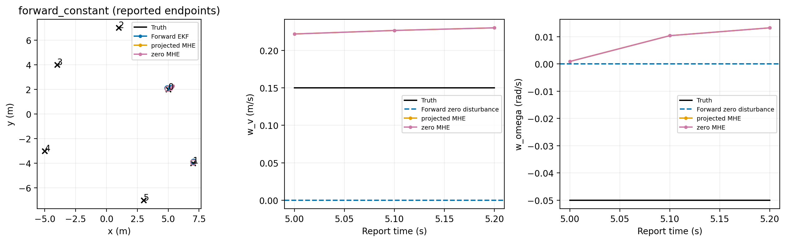

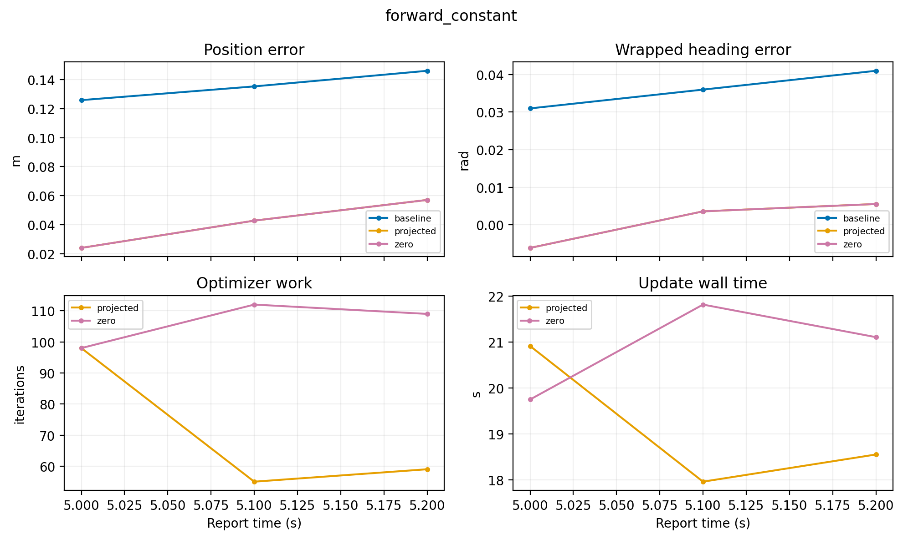

- forward_smooth/projected: endpoint disturbance RMSE is worse than the zero-disturbance baseline for w_v.
- forward_smooth/zero: endpoint disturbance RMSE is worse than the zero-disturbance baseline for w_v.

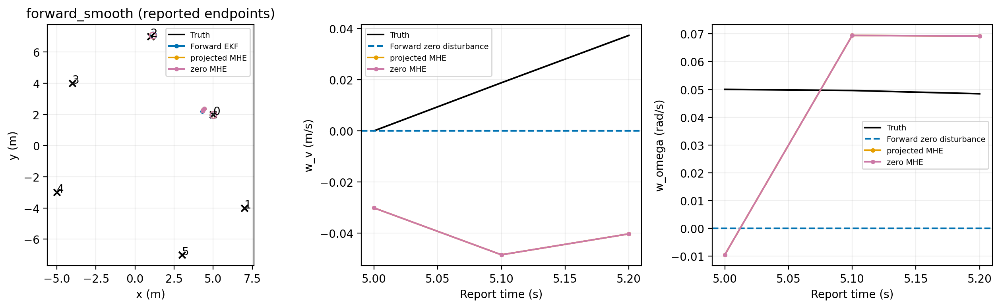

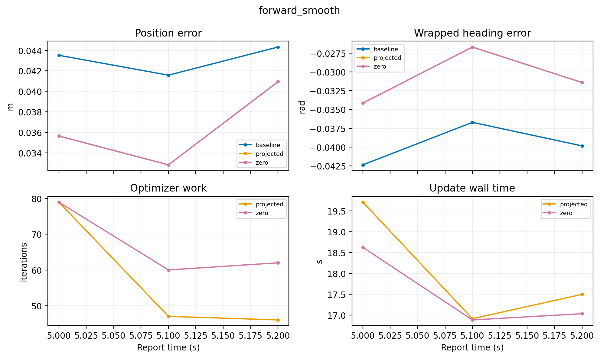

- forward_zero/projected: lower-cost fitting does not guarantee accuracy; worse than forward EKF in position_rmse_m, heading_rmse_rad, landmark_rmse_m.
- forward_zero/projected: endpoint disturbance RMSE is worse than the zero-disturbance baseline for w_v, w_omega.
- forward_zero/zero: lower-cost fitting does not guarantee accuracy; worse than forward EKF in position_rmse_m, heading_rmse_rad, landmark_rmse_m.
- forward_zero/zero: endpoint disturbance RMSE is worse than the zero-disturbance baseline for w_v, w_omega.

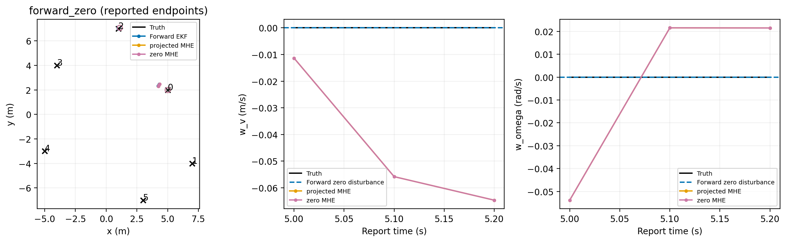

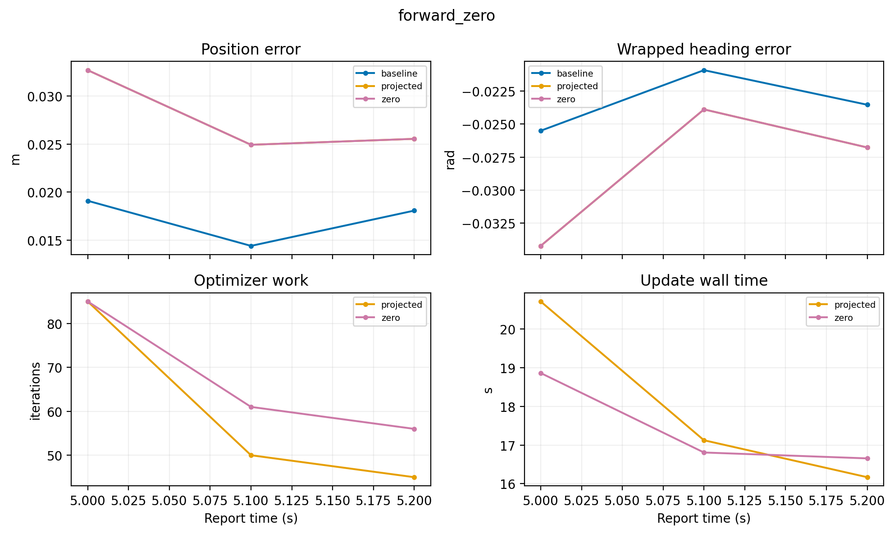


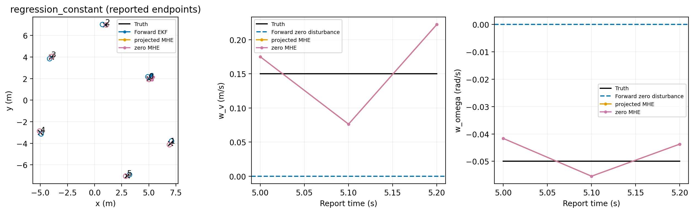

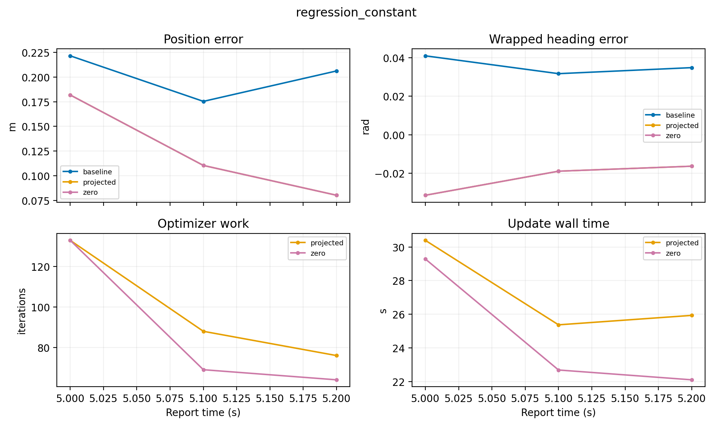

- regression_smooth/projected: lower-cost fitting does not guarantee accuracy; worse than forward EKF in position_rmse_m, heading_rmse_rad, landmark_rmse_m.
- regression_smooth/projected: endpoint disturbance RMSE is worse than the zero-disturbance baseline for w_v.
- regression_smooth/zero: lower-cost fitting does not guarantee accuracy; worse than forward EKF in position_rmse_m, heading_rmse_rad, landmark_rmse_m.
- regression_smooth/zero: endpoint disturbance RMSE is worse than the zero-disturbance baseline for w_v.

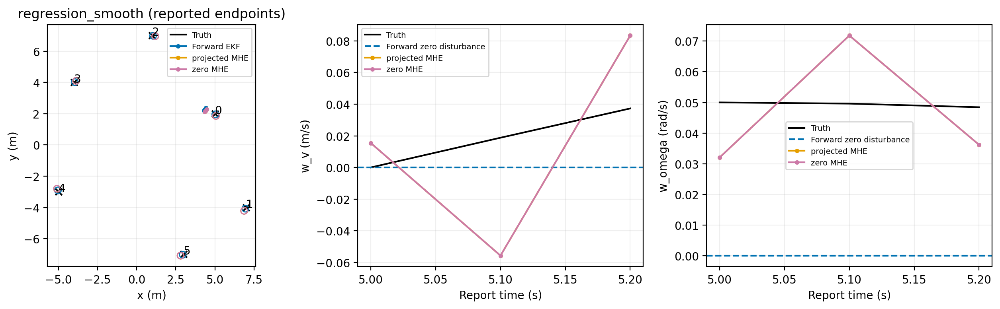

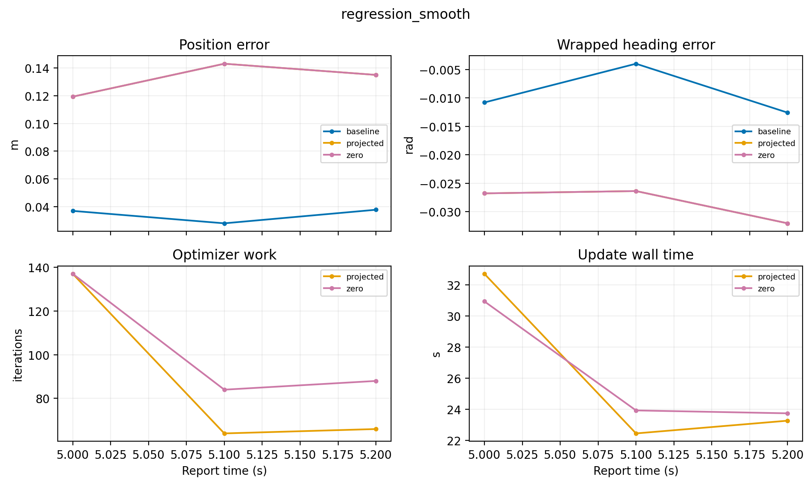

- regression_zero/projected: lower-cost fitting does not guarantee accuracy; worse than forward EKF in position_rmse_m, heading_rmse_rad, landmark_rmse_m.
- regression_zero/projected: endpoint disturbance RMSE is worse than the zero-disturbance baseline for w_v, w_omega.
- regression_zero/zero: lower-cost fitting does not guarantee accuracy; worse than forward EKF in position_rmse_m, heading_rmse_rad, landmark_rmse_m.
- regression_zero/zero: endpoint disturbance RMSE is worse than the zero-disturbance baseline for w_v, w_omega.

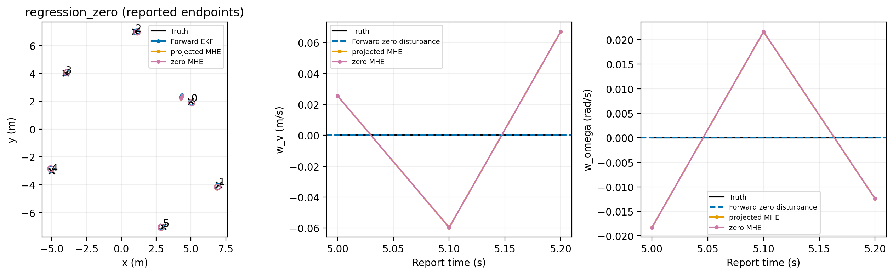

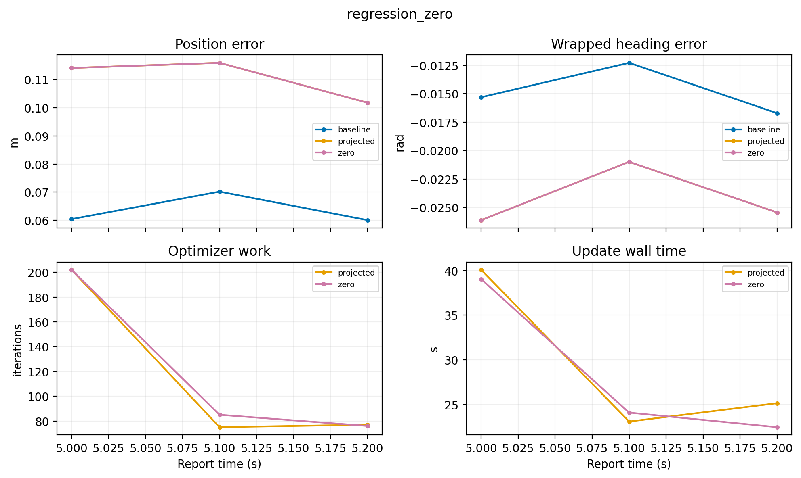

## Executed validation

The complete implementation gate passed **381 tests**, exit 0, subprocess wall time 378.134 s, before benchmarks.

```sh
PYTHONPATH=build/bsplines_library MPLCONFIGDIR=/tmp/bspline_mhe_mpl python3 -B -m pytest -q --junitxml=artifacts/milestone5b/pytest.xml -o junit_family=legacy
```

Saved cases contain 36 optimization runs; 36 report convergence. See implementation_gate.json, pytest_stdout.txt, pytest.xml, pilot_stdout.txt and suite_stdout.txt for actual evidence. The three-update implementation test is independently rerun twice and checks exact coefficients/costs; the full noisy six-case suite is one seed, not multiple independent trials.

All 556 captured pre-task files remain unchanged: True. Stage 5A, Stage 4C, the original baseline and all earlier artifacts are protected by SHA-256. Only new Stage 5B modules, tests, documentation and artifact files were added.

```json
{
  "all_schedules_complete": true,
  "boundary_arrivals_and_masks": true,
  "birth_accounting": true,
  "same_map_ids_as_forward": true,
  "projection_and_clipping": true,
  "first_fits_identical": true,
  "all_six_cases_present": true,
  "all_original_files_preserved": true,
  "implementation_gate_passed": true,
  "saved_full_window_gradients_passed": true
}
```

Saved full-size windows additionally check every coefficient at zero, a nonconstant vector and the fitted vector, using float64 central differences at steps 1e-4 and 1e-5. All checks passed: True; largest absolute discrepancy 1.659552e-06. Original rtol/atol 2e-5 and max-absolute-error <2e-5 are unchanged. Bound-active coefficients are checked in the valid ambient objective domain, not by differentiating clipping. See gradient_checks.json and gradient_stdout.txt.

```sh
PYTHONPATH=build/bsplines_library MPLCONFIGDIR=/tmp/bspline_mhe_mpl python3 -B -m benchmarks.milestone5b_gradients
```

## Proposed Monte Carlo plan — approval required

The six-case one-seed run sums to 825.0 s in recorded forward/MHE estimation phases (13.75 min), excluding tests, artifact I/O, plots and extra profiling. At that measured cost, 15 paired variance-pilot seeds would require approximately 3.44 h; a 97-trial final run would require roughly 22.23 h for the same short cases.

Recommend extending deterministic trajectories and reducing repeated compilation first. Then, with approval, use 15 paired pilot seeds to estimate the across-seed standard deviation of the paired position-RMSE difference (approximate relative standard error of the SD is 1/sqrt(2*(15-1)) = 19%). For a 95% paired-mean confidence-interval half-width of 0.01 m, estimate N≈(1.96*s_delta/0.01)^2, then use Student-t critical values and the pilot uncertainty to revise N upward. For illustration, s_delta=0.02 m suggests about 16 trials; s_delta=0.05 m suggests 97. These SDs are assumptions, not measured across-seed estimates. A single seed cannot determine a statistically justified final trial count. Seeds, not overlapping windows, are the independent experimental units. Update this runtime budget after selecting longer deterministic trajectories. No Monte Carlo trial has been run.

## Reproduce and next steps

```sh
PYTHONPATH=build/bsplines_library MPLCONFIGDIR=/tmp/bspline_mhe_mpl python3 -B -m benchmarks.milestone5b --case all --rerun
```

Without --rerun, existing completed cases are reused. A different duration requires --rerun or a fresh output with its own implementation gate and preservation snapshot. See estimation/STAGE5B.md for validation commands and implementation details. Inspect clipping and overlap revisions, profile longer deterministic runs and reduce repeated compilation before drawing broad performance conclusions. Monte Carlo, nearest-neighbor association and Victoria Park require additional approval.
